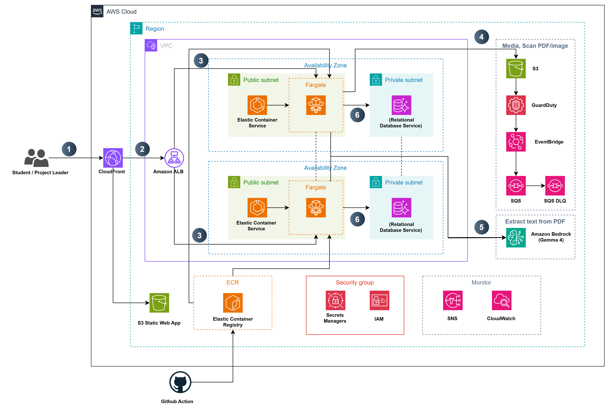

# Tindy — AI-Powered Project & Teammate Matching Platform on AWS

**Student Author:** Cao Thành Nhân  
**Role:** Frontend Engineer (React / TypeScript / Tailwind CSS) & Backend Optimization (CORS, Rate Limiting)  
**Project:** Tindy — AI-Powered Community & Project Matching Platform  
**Target Community:** First Cloud AI Journey (FCAJ) Community  

---

## 1. Executive Summary

**Tindy** is an AI-powered web platform designed specifically for the **First Cloud AI Journey (FCAJ)** student community, bridging the gap between individuals seeking project opportunities and teams looking for specific technical competencies.

In student tech communities, recruitment and team-formation details are frequently scattered across unstructured channels such as Facebook groups, Discord servers, and direct messages. Introverted students often hesitate to initiate conversations with strangers, while project leaders struggle to locate candidates with the exact skills required (for instance, a team having solid frontend and backend developers but lacking an AI/ML engineer). Tindy resolves this challenge through an intelligent, transparent matching mechanism:

- **For Students/Members:** Build a centralized technical profile; explore recommended projects with transparent Match Scores; express interest via intuitive actions (**Interested**, **Skip**, **Save for Later**); understand recommendations via **AI Explain Match**; and chat directly with project leads within the platform.
- **For Project Leaders:** Post project opportunities with structured requirements akin to Job Descriptions; receive curated candidate recommendations; manage applications and send invitations; and track open positions and team seats in real time.

The system is architected as a Cloud-Native solution on **AWS (US East, `us-east-1`)**. The frontend is built with **React, TypeScript, and Tailwind CSS**, bundled using **Vite**, and served globally via **Amazon CloudFront** backed by private **Amazon S3** storage with Origin Access Control (OAC). The backend uses **ASP.NET Core (.NET 10)** deployed on containerized **Amazon ECS Fargate** behind an **Internal Application Load Balancer (ALB)** routed through **CloudFront VPC Origins**. The solution is powered by **Amazon RDS for PostgreSQL 17**, **Amazon Bedrock** for generative AI features, and **AWS GuardDuty**, **EventBridge**, and **SQS** for secure asynchronous file processing.

---

## 2. Problem Statement, Solution, and Functional Scope

### 2.1. Problem Statement

1. **Hesitation in Cold Outreach:** Introverted students often feel uncomfortable messaging strangers directly (*"Can I join your project?"*), missing out on valuable collaborative opportunities despite having matching skills.
2. **Missing Complementary Skillsets:** Project teams frequently form around existing circles of friends, resulting in duplicate skillsets while lacking vital specialized roles (e.g., Cloud/DevOps or AI engineering).
3. **Fragmented Professional Profiles:** Evidence of student competence is dispersed across GitHub, LinkedIn, AWS certification badges, and static CV files, making qualification verification tedious for team leads.
4. **Disjointed Communication:** Fragmented communication across third-party chat apps leads to lost recruitment context and uncoordinated team finalization.
5. **Limitations of Keyword Matching:** Traditional keyword filtering fails to recognize semantic alignment between project requirements (*"Experience with RAG systems and LLMs"*) and student descriptions (*"Built an AI chatbot using Amazon Bedrock and pgvector"*).

### 2.2. Proposed Solution

Tindy establishes a streamlined, end-to-end recruitment lifecycle:
```text
Student Profile
       +
Project Requirements (JD)
       ↓
AI Matching Engine (Deterministic Rules + Semantic Similarity)
       ↓
Recommended Projects
       ↓
Student clicks "Interested"
       ↓
Project Lead reviews candidate profile & AI explanation
       ↓
Internal Real-Time Chat (SignalR WebSocket)
       ↓
Acceptance & Team Membership (Seat count updated)
```

Unlike traditional dating applications, Tindy does **not** feature user-to-user swiping. Instead, students interact directly with **Projects and Positions**. This approach preserves professional dignity, minimizes fear of rejection, and fosters a collaborative community ethos.

### 2.3. Functional Scope

| Workflow | Frontend Action (UI) | Backend & System Processing |
| :--- | :--- | :--- |
| **Profile Building & AI Extraction** | Member enters technical skills, preferred roles, and availability (hrs/week). Can upload CV PDF or text for Amazon Bedrock extraction. | UI displays a structured draft of skills and experience. Member reviews, edits, and saves the verified data to PostgreSQL. |
| **Project Discovery & Application** | Member browses recommended projects, views Match Scores, and selects **Interested**, **Skip**, or **Save**. | Application status is marked as **Pending**. Project lead receives notification of a new interested candidate. |
| **Candidate Management & Approval** | Lead reviews candidate list by position, inspects profile details and AI match reasons, then clicks **Accept** or **Decline**. | On acceptance, API verifies eligibility and seat availability; candidate becomes a project member; position seat count increments. |
| **Internal Real-Time Chat** | Members and leaders communicate 1-on-1 or within project workspace chat rooms. | Messages are delivered instantly over WebSockets via SignalR. Backend **Rate Limiting** prevents spamming and flooding. |
| **Release & Operations** | Engineers build and deploy static frontend to S3, build Docker images to ECR, and orchestrate CloudFormation stacks. | The entire platform operates under a unified HTTPS CloudFront hostname with maintenance mode and `/api/health/ready` verification. |

### 2.4. Match Scoring Formula and AI Explain Match

Match scores are calculated using a deterministic weighted formula combined with semantic analysis, ensuring objective and predictable recommendations:

$$\text{Match Score} = (0.40 \times S_{\text{required}}) + (0.30 \times S_{\text{role}}) + (0.20 \times S_{\text{availability}}) + (0.10 \times S_{\text{optional}})$$

- **Required Technical Skills (40%):** Proportion of mandatory skills possessed by the student.
- **Preferred Role (30%):** Alignment between the student’s career focus (e.g., Frontend Developer) and the open position.
- **Availability (20%):** Comparison between student's available hours/week and project commitment requirements.
- **Optional / Bonus Skills (10%):** Nice-to-have technical skills.

**Frontend AI Explain Match Card:** The user interface does not merely display a percentage (*e.g., 88% Match*); it provides an interactive popover detailing:
- **Strong Matches:** Proficient in React, TypeScript, Tailwind CSS; Matches Frontend Role; Meets 10 hrs/week commitment.
- **Skill Gap:** No prior experience noted with Next.js or GraphQL (offering targeted guidance for future learning).

---

## 3. Solution Architecture



### 3.1. Layered Architecture

1. **Frontend Layer:**
   - Engineered with **React 18** and **TypeScript**, bundled with **Vite** for fast load times and clean modular code.
   - Modern, responsive styling implemented with **Tailwind CSS**.
   - Client state and server data caching managed through React Context / Custom Hooks and typed HTTP clients.
   - Real-time bidirectional communication powered by `@microsoft/signalr`.
   - Stored in a private **Amazon S3** bucket and distributed globally through **Amazon CloudFront** with Origin Access Control (OAC).
2. **Edge & Routing Layer:**
   - Amazon CloudFront acts as the single reverse proxy:
     * Static assets (`/*`): Cached at edge locations from the S3 bucket.
     * Dynamic API routes (`/api/*`): Forwarded through **CloudFront VPC Origins** to the internal ALB with caching disabled.
     * Real-time Chat routes (`/hubs/*`): Supports WebSocket connection upgrade (`HTTP 101 Switching Protocols`) to backend tasks.
3. **Application & Backend Layer:**
   - **ASP.NET Core (.NET 10)** following Clean Architecture (`Domain`, `Application`, `Infrastructure`, `API`).
   - Packaged as a Docker container stored in **Amazon ECR**, executed serverlessly on **Amazon ECS with AWS Fargate** within private subnets.
4. **Data & Storage Layer:**
   - **Amazon RDS for PostgreSQL 17** deployed in private database subnets with TLS encryption.
   - **Amazon S3 Media Bucket** (Private) for avatar images and CV documents.
   - **AWS GuardDuty Malware Protection** scans uploaded PDFs $\rightarrow$ **EventBridge** captures scan verdicts $\rightarrow$ **Amazon SQS** queues asynchronous processing $\rightarrow$ updates file validity before AI processing.
5. **AI Layer:**
   - Integrates **Amazon Bedrock** for CV parsing, automated profile summarization, and match explanations.

### 3.2. Author's Technical Contributions (Frontend & Backend)

As the Frontend Engineer and Backend Contributor on project Tindy, **Cao Thành Nhân** personally led the implementation of:

#### Frontend Responsibilities:
- **Client Architecture:** Designed the modular component structure, enforced strict typing with TypeScript, and established the UI design system using Tailwind CSS.
- **Core User Interfaces:**
  1. *Authentication & Onboarding:* Interactive login/register views and profile initialization wizards.
  2. *Interactive Profile Builder:* Skill tag selectors, availability commitment sliders, CV preview, and the AI Profile Draft Review component.
  3. *Project Discovery & Matching:* Project recommendation cards, match percentage badges, Explain Match popovers, and quick interaction buttons (Interested, Skip, Save).
  4. *Team Management & Candidate Review:* Project Lead management table, interested candidate review modal, and acceptance/rejection workflows.
  5. *Real-Time Chat Interface:* Embedded messaging component with typing indicators, real-time message streams, and active connection management.
- **Network & WebSocket Integration:** Integrated `@microsoft/signalr` with automatic reconnection; normalized API calls through the unified CloudFront origin (`/api`).

#### Backend Contributions & Optimizations:
- **Cross-Origin Resource Sharing (CORS) Configuration:** Fine-tuned and secured CORS policies in ASP.NET Core (`Program.cs`), permitting authorized CloudFront distribution domains and local development environments to communicate seamlessly with `/api/*` and WebSocket endpoints without browser security blocks.
- **Message Request Throttling & Rate Limiting:**
  * Implemented rate-limiting middleware for chat message submission and SignalR hubs.
  * Mitigated spamming and flood requests that could degrade ECS Fargate container performance or incur runaway cloud costs.
  * Ensured messaging stability and high availability during concurrent student interactions.

---

## 4. Implementation and Testing

### 4.1. Six CloudFormation Stacks

Infrastructure is codified using 6 decoupled AWS CloudFormation templates:

| Order | Stack Name | Template | Key Resources |
| :---: | :--- | :--- | :--- |
| **1** | `tindy-foundation` | `foundation.yaml` | S3 Buckets, ECR Repository, Secrets Manager, IAM Roles, GitHub OIDC Provider. |
| **2** | `tindy-network` | `network.yaml` | VPC (2 AZs), Public/Private Subnets, Route Tables, Internet Gateway, Security Groups. |
| **3** | `tindy-database` | `database.yaml` | RDS PostgreSQL 17 (`db.t4g.micro`), DB Subnet Group, Parameter Group. |
| **4** | `tindy-integrations` | `integrations.yaml`| GuardDuty Malware Plan, EventBridge Rule, SQS Queue, DLQ, CloudWatch Alarms. |
| **5** | `tindy-runtime` | `runtime.yaml` | ECS Cluster, Fargate Task Definition, Internal ALB, CloudFront VPC Origin. |
| **6** | `tindy-edge` | `edge.yaml` | CloudFront Distribution, Origin Access Control (OAC), Cache Behaviors, Maintenance Routing. |

### 4.2. CI/CD & Frontend Deployment Workflow

1. **Backend Deployment:** GitHub Actions builds ASP.NET Core Docker images, pushes them to ECR with pinned digests, and updates the ECS task definition with zero-downtime rolling deployment.
2. **Frontend Deployment:**
   * Build execution: `npm run build` generates the production-optimized `dist/` bundle.
   * Synchronization: GitHub Actions (assuming `FrontendDeployRole` via secure OIDC) synchronizes assets to the S3 bucket using `aws s3 sync`.
   * Edge Invalidation: Executes `aws cloudfront create-invalidation --paths "/*"` to purge edge caches immediately.
3. **Maintenance Mode:** The Edge template supports dynamic switching between `maintenance` (serving a static maintenance page from S3) and `live` (routing dynamic requests to ALB).

---

## 5. Timeline and Sprint Plan

The implementation spans 7 weeks (Weeks 4 to 10 of the internship curriculum):

| Sprint | Timeline | Frontend & Backend Development Focus | Deliverables |
| :--- | :---: | :--- | :--- |
| **Sprint 1** | **Weeks 4–5** | • UI/UX wireframing.<br>• React + TypeScript + Tailwind CSS project setup.<br>• Auth, Onboarding, and Profile views.<br>• *BE:* Initial CORS configuration and profile endpoints. | Demo users can authenticate and manage profiles via the web UI. |
| **Sprint 2** | **Weeks 6–7** | • Project Discovery interface.<br>• Project recommendation cards, Match Score badges, Explain Match popover.<br>• Interested / Skip / Save interactions.<br>• Candidate management dashboard for leads. | End-to-end application lifecycle functioning between student and lead. |
| **Sprint 3** | **Weeks 8–9** | • Real-time chat integration with `@microsoft/signalr`.<br>• *BE:* Chat rate limiting and message throttling middleware.<br>• AI Profile Draft review component.<br>• Static build scripts and CI/CD GitHub Actions setup. | 1-on-1 chat operational with anti-spam protection; AI review UI functional. |
| **Sprint 4** | **Week 10** | • Full deployment of 6 CloudFormation stacks on AWS `us-east-1`.<br>• Frontend release to S3 and CloudFront.<br>• End-to-end UI verification under CloudFront HTTPS domain.<br>• Workshop documentation and report finalization. | Live demo on AWS; `/api/health/ready` returns HTTP `200 Healthy`. |

---

## 6. Budget Estimation

Estimated using the **AWS Pricing Calculator** for Region **US East (N. Virginia, `us-east-1`)**, maintaining cost-effectiveness for academic experimentation:

| AWS Service | Configuration Detail | Monthly Estimate (USD) |
| :--- | :--- | :---: |
| **AWS Fargate (Backend API)** | 1 Linux/x86 Task (0.5 vCPU, 2 GiB RAM) running 730 hours/month | $21.26 |
| **Internal Application Load Balancer** | 1 Internal ALB connected to VPC Origin (730 hours) | $16.43 |
| **Amazon RDS for PostgreSQL** | Instance `db.t4g.micro` Single-AZ ($11.68) + 20 GiB gp3 Storage ($2.30) | $13.98 |
| **Public IPv4 Address** | 1 public IPv4 address for Fargate task (730 hours) | $3.65 |
| **Amazon CloudFront & S3** | Static frontend hosting, global CDN distribution, OAC security | Pay-per-use (~$1.00) |
| **Amazon Bedrock, Secrets Manager, CloudWatch** | On-demand AI extraction, 4 active secrets, monitoring logs | Pay-per-use (~$1.80) |
| **TOTAL MONTHLY ESTIMATE (Baseline)** | **Always-on deployment model** | **~$55.32 – $58.12 / month** |

> **Cost Control Measures:**
> - Configured **AWS Budgets** alerts at $30 and $50 thresholds.
> - Scheduled deployment practices (suspending tasks when not demonstrating, toggling CloudFront maintenance mode, or executing Workshop 5.7 cleanup) keep actual internship spending under **$15 USD total**.

---

## 7. Risk Assessment

| Technical Risk | Impact | Mitigation Strategy |
| :--- | :--- | :--- |
| **Browser CORS or WebSocket Rejection** | Frontend unable to reach API or establish SignalR connections. | Explicit CORS policies configured in ASP.NET Core allowing CloudFront domains; unified routing under a single HTTPS origin. |
| **Message Flooding & Chat Spamming** | CPU exhaustion on Fargate task; service degradation. | Implemented **Message Rate Limiting & Throttling** middleware at API layer to enforce safe request thresholds. |
| **Generative AI Hallucinations** | Inaccurate candidate skill or experience extraction. | AI results are not committed directly to PostgreSQL; the frontend enforces a mandatory **Review & Edit** stage prior to saving. |
| **Network Latency & Slow Page Loads** | Sluggish UI navigation on slower networks. | CloudFront edge caching for static assets, code-splitting with React lazy loading, and skeleton loading states. |
| **Unplanned Cloud Expenses** | Exceeding program budget allowances. | CloudFormation automated teardown procedures (Workshop 5.7) and CloudWatch billing alerts. |

---

## 8. Acceptance Criteria

| Test Case | UI Verification Procedure | Pass Criteria |
| :--- | :--- | :--- |
| **TC01: Authentication & Navigation** | Access CloudFront HTTPS domain and log in with demo credentials. | Successful login redirects to home dashboard; user profile and navigation items render properly. |
| **TC02: Profile Editing & AI Extraction** | Navigate to Profile, update skills, upload sample CV, trigger AI extraction. | Structured skill tags generated by Amazon Bedrock appear on the review card; edits save successfully to PostgreSQL. |
| **TC03: Project Discovery & Match Score** | Open Project Discovery page and view project cards. | Each project card displays the computed Match Score badge; clicking opens the Explain Match popover. |
| **TC04: Expressing Interest (Application)** | Click **Interested** on an open project position. | Application status updates to Pending; toast notification confirms submission; button state updates to prevent duplicate clicks. |
| **TC05: Candidate Review & Seat Tracking** | Log in as Project Lead, open Candidate Review modal, click **Accept**. | Candidate appears in project member list; position filled-seat count increments by 1; UI synchronizes immediately. |
| **TC06: Real-Time Chat (WebSocket)** | Open two concurrent browser sessions (Student and Lead) and exchange messages. | Messages appear instantaneously in both views over WebSocket connection (`HTTP 101 Switching Protocols` in DevTools). |
| **TC07: Rate Limiting Enforcement** | Attempt to flood messages in rapid succession. | Excessive requests are throttled with a graceful notification on UI; container health remains stable. |
| **TC08: Edge & API Readiness** | Send GET request to `https://<domain>/api/health/ready`. | Returns HTTP `200 OK` with JSON body `{"status":"Healthy","service":"Tindy API"}`. |

---

*Detailed infrastructure provisioning procedures and end-to-end UI verification steps are documented in **[Section 5 — Workshop](/5-workshop/)**.*
