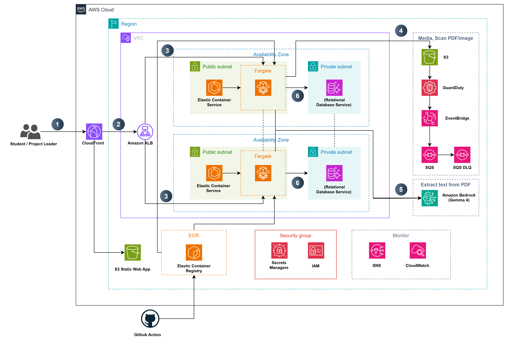

# Tindy — Nền tảng AI Matching Dự án và Đồng đội trên AWS

**Sinh viên thực hiện:** Cao Thành Nhân  
**Vai trò:** Kỹ sư Frontend (React / TypeScript / Tailwind CSS) & Tối ưu hóa Backend (CORS, Rate Limiting)  
**Dự án:** Tindy — AI-Powered Community & Project Matching Platform  
**Cộng đồng mục tiêu:** First Cloud AI Journey (FCAJ) Community  

---

## 1. Tóm tắt đề xuất (Executive Summary)

**Tindy** là nền tảng web ứng dụng Trí tuệ Nhân tạo (AI) giúp sinh viên và thành viên cộng đồng **First Cloud AI Journey (FCAJ)** tìm kiếm dự án, xây dựng đội ngũ và kết nối với đồng đội phù hợp với kỹ năng kỹ thuật, mục tiêu học tập và thời gian khả dụng.

Trong các cộng đồng học tập công nghệ, thông tin tuyển thành viên thường nằm rải rác trên Facebook Groups, Discord, Zalo hoặc trao đổi cá nhân. Sinh viên hướng nội thường ngại chủ động nhắn tin ngỏ lời, trong khi các trưởng nhóm (Project Leader) gặp khó khăn khi tìm kiếm ứng viên có đúng kỹ năng mà dự án đang thiếu (ví dụ: team đã có FE/BE nhưng thiếu AI Engineer). Tindy giải quyết triệt để bài toán này bằng cách cung cấp một nền tảng tập trung với cơ chế matching thông minh:

- **Dành cho Thành viên (Student):** Xây dựng hồ sơ năng lực tập trung; Khám phá dự án với điểm tương thích (Match Score) minh bạch; Thể hiện nguyện vọng tham gia bằng hành động trực quan (**Interested**, **Skip**, **Save for Later**); Nhận giải thích lý do đề xuất từ AI (**AI Explain Match**); Trò chuyện trực tiếp với trưởng nhóm ngay trong hệ thống.
- **Dành cho Trưởng nhóm (Project Leader):** Đăng tuyển dự án tương tự một bản Job Description chi tiết; Tự động nhận đề xuất danh sách ứng viên tiềm năng; Quản lý đơn ứng tuyển và gửi lời mời tham gia; Quản lý số lượng chỗ trống (seats) theo thời gian thực.

Hệ thống được thiết kế theo kiến trúc Cloud-native trên **AWS (Region `us-east-1`)**. Frontend được xây dựng bằng **React, TypeScript, Tailwind CSS**, đóng gói bằng **Vite**, phân phối toàn cầu qua **Amazon CloudFront** và lưu trữ tĩnh tại **Amazon S3**. Backend sử dụng **ASP.NET Core (.NET 10)** chạy trên container **Amazon ECS Fargate** sau một **Internal Application Load Balancer (ALB)** thông qua **CloudFront VPC Origin**, kết hợp cơ sở dữ liệu **Amazon RDS PostgreSQL 17**, **Amazon Bedrock** cho tính năng AI, cùng **AWS GuardDuty**, **EventBridge** và **SQS** để xử lý tệp tin an toàn.

---

## 2. Bài toán, Giải pháp và Phạm vi chức năng

### 2.1. Phân tích bài toán thực tế

1. **Khó khăn khi mở lời kết nối:** Sinh viên mới hoặc có tính cách hướng nội thường cảm thấy e ngại khi phải chủ động nhắn tin cho người lạ: *"Mình có thể tham gia project của bạn không?"*. Họ dễ bỏ lỡ các cơ hội thực hành dù kỹ năng hoàn toàn đáp ứng.
2. **Thiếu mảnh ghép chuyên môn cụ thể:** Một nhóm dự án thường hình thành từ bạn bè cùng lớp, dễ dẫn đến tình trạng "thừa người trùng kỹ năng, thiếu kỹ năng then chốt" (như thiếu Cloud/DevOps hoặc Data/AI).
3. **Hồ sơ năng lực bị phân tán:** Bằng chứng năng lực của sinh viên nằm rải rác trên GitHub, LinkedIn, chứng chỉ AWS, CV PDF cá nhân, khiến trưởng nhóm mất nhiều thời gian xác minh.
4. **Phân mảnh giao tiếp:** Việc trao đổi qua nhiều ứng dụng nhắn tin ngoài luồng làm mất ngữ cảnh tuyển chọn và khó theo dõi tiến độ chốt thành viên.
5. **Hạn chế của tìm kiếm từ khóa truyền thống:** Tìm kiếm từ khóa thuần túy không nhận diện được sự tương đồng ngữ nghĩa giữa yêu cầu dự án (ví dụ: *"Kinh nghiệm RAG và LLM"*) và mô tả của sinh viên (*"Đã xây dựng chatbot bằng Bedrock và pgvector"*).

### 2.2. Giải pháp đề xuất

Tindy áp dụng quy trình kết nối khép kín (Core Workflow):
```text
Hồ sơ sinh viên (Student Profile)
          +
Yêu cầu tuyển dụng (Project Requirements)
          ↓
AI Matching Engine (Trọng số nghiệp vụ + Ngữ nghĩa)
          ↓
Danh sách dự án đề xuất (Recommended Projects)
          ↓
Sinh viên bấm "Interested" (Bày tỏ quan tâm)
          ↓
Trưởng nhóm duyệt hồ sơ & Mời trò chuyện
          ↓
Chat nội bộ thời gian thực (SignalR Chat)
          ↓
Xác nhận vào nhóm (Join Team) & Cập nhật số chỗ
```

Khác với các ứng dụng hẹn hò thông thường, Tindy **không** để người dùng swipe người với người, mà sinh viên tương tác trực tiếp với **Dự án và Vị trí tuyển dụng**. Cách tiếp cận này tạo môi trường học tập chuyên nghiệp, văn minh và tôn trọng ứng viên.

### 2.3. Phạm vi bản demo (Demo Scope)

| Luồng nghiệp vụ | Thao tác người dùng (UI Frontend) | Xử lý hệ thống & Kết quả |
| :--- | :--- | :--- |
| **Xây dựng hồ sơ & AI Profile** | Thành viên nhập thông tin, kỹ năng, vai trò mong muốn, số giờ rảnh/tuần. Có thể tải lên CV PDF hoặc văn bản để AI Bedrock trích xuất bản nháp. | Giao diện hiển thị bản nháp có cấu trúc (kỹ năng, kinh nghiệm). Thành viên xem lại, chỉnh sửa và bấm lưu vào PostgreSQL. |
| **Khám phá & Ứng tuyển dự án** | Thành viên lướt xem các dự án được đề xuất, xem điểm phù hợp và bấm **Interested** (Ứng tuyển), **Skip** hoặc **Save**. | Đơn chuyển sang trạng thái **Pending**. Trưởng nhóm nhận thông báo có ứng viên mới bày tỏ quan tâm. |
| **Quản lý ứng viên & Duyệt đơn** | Trưởng nhóm xem danh sách ứng viên theo vị trí, xem hồ sơ chi tiết và phân tích AI, sau đó bấm **Accept** hoặc **Decline**. | Khi chấp nhận, API kiểm tra tính hợp lệ và số chỗ trống. Thành viên chính thức gia nhập dự án; số chỗ của vị trí tự động cập nhật. |
| **Trò chuyện nội bộ (Internal Chat)** | Thành viên và trưởng nhóm trao đổi 1-1 hoặc trò chuyện trong nhóm dự án thông qua khung chat tích hợp. | Tin nhắn được truyền tải tức thời qua WebSocket (SignalR). Hệ thống áp dụng **Rate Limiting** để chống spam. |
| **Vận hành & Phát hành** | Kỹ sư triển khai build tĩnh FE lên S3, build Docker image BE lên ECR, cập nhật CloudFormation stacks. | Hệ thống hoạt động trên cùng một hostname HTTPS CloudFront duy nhất, có trang bảo trì và kiểm tra trạng thái `/api/health/ready`. |

### 2.4. Công thức tính điểm tương thích (Match Scoring) & AI Explain Match

Hệ thống kết hợp giữa **quy tắc nghiệp vụ xác định (Deterministic Business Rules)** và **phân tích ngữ nghĩa** để đưa ra điểm số khách quan, minh bạch thay vì để LLM tự phán đoán ngẫu nhiên:

$$\text{Match Score} = (0.40 \times S_{\text{required}}) + (0.30 \times S_{\text{role}}) + (0.20 \times S_{\text{availability}}) + (0.10 \times S_{\text{optional}})$$

- **Kỹ năng bắt buộc (40%):** Tỷ lệ kỹ năng sinh viên đáp ứng so với yêu cầu của vị trí.
- **Vai trò mong muốn (30%):** Mức độ trùng khớp giữa vai trò sinh viên hướng tới (ví dụ: Frontend Dev) và vị trí dự án đang tuyển.
- **Thời gian khả dụng (20%):** So sánh số giờ sinh viên có thể cam kết mỗi tuần với yêu cầu của dự án (ví dụ: sinh viên rảnh 10h/tuần đáp ứng yêu cầu 8h/tuần sẽ đạt điểm tối đa).
- **Kỹ năng bổ sung (10%):** Các kỹ năng điểm cộng (nice-to-have).

**Tính năng AI Explain Match trên giao diện:** Người dùng không chỉ nhìn thấy con số (ví dụ: *88% Match*), mà giao diện FE sẽ hiển thị popover/card giải thích rõ:
- **Điểm mạnh (Strong Matches):** Đã có kinh nghiệm React, TypeScript, Tailwind CSS; Đúng vai trò Frontend; Đảm bảo thời gian 10h/tuần.
- **Kỹ năng còn thiếu (Skill Gap):** Chưa có kinh nghiệm với GraphQL hoặc Next.js (giúp sinh viên định hướng học thêm).

---

## 3. Kiến trúc giải pháp (Solution Architecture)



### 3.1. Phân tầng kiến trúc hệ thống

Hệ thống được tổ chức thành 5 tầng rõ ràng, đảm bảo tính phân tách trách nhiệm (Separation of Concerns):

1. **Tầng Giao diện Người dùng (Frontend Layer):**
   - Xây dựng bằng **React 18** và **TypeScript**, biên dịch tối ưu hóa bằng **Vite**.
   - Thiết kế giao diện hiện đại, responsive bằng **Tailwind CSS**.
   - Quản lý trạng thái client và đồng bộ dữ liệu server qua React Context / Custom Hooks và Fetch/Axios Client.
   - Kết nối giao tiếp hai chiều thời gian thực qua thư viện `@microsoft/signalr`.
   - Lưu trữ dạng tĩnh trên **Amazon S3** và phân phối qua mạng biên **Amazon CloudFront** với chứng chỉ SSL/TLS tự động và Origin Access Control (OAC).
2. **Tầng Định tuyến Mạng Biên (Edge & Routing Layer):**
   - CloudFront đóng vai trò reverse proxy duy nhất:
     * Request tĩnh (`/*`): Phục vụ từ S3 frontend bucket với chính sách cache tối ưu.
     * Request API (`/api/*`): Chuyển tiếp động qua **CloudFront VPC Origin** đến Application Load Balancer (ALB) nội bộ, vô hiệu hóa cache (`CachingDisabled`).
     * Request Chat thời gian thực (`/hubs/*`): Chuyển tiếp WebSocket nâng cấp giao thức (`HTTP 101 Switching Protocols`) tới API task.
3. **Tầng Dịch vụ Ứng dụng (Application / Backend Layer):**
   - Ứng dụng **ASP.NET Core (.NET 10)** thiết kế theo mô hình Clean Architecture (`Tindy.Domain`, `Tindy.Application`, `Tindy.Infrastructure`, `Tindy.API`).
   - Đóng gói trong Docker container, lưu trữ tại **Amazon ECR**, vận hành không máy chủ trên **Amazon ECS với AWS Fargate** đặt trong mạng VPC có Security Group siết chặt.
4. **Tầng Dữ liệu & Xử lý tệp (Data & Storage Layer):**
   - Cơ sở dữ liệu quan hệ **Amazon RDS for PostgreSQL 17** đặt trong Private Database Subnet, kết nối bảo mật qua TLS.
   - **Amazon S3 Media Bucket** (Private) lưu trữ ảnh đại diện và tệp CV PDF.
   - Luồng bảo mật tệp: **AWS GuardDuty Malware Protection** quét virus tệp PDF tải lên $\rightarrow$ **Amazon EventBridge** bắt sự kiện kết quả $\rightarrow$ **Amazon SQS** làm hàng đợi xử lý bất đồng bộ $\rightarrow$ Cập nhật trạng thái an toàn trước khi cho phép đọc/trích xuất.
5. **Tầng Trí tuệ Nhân tạo (AI Layer):**
   - Tích hợp **Amazon Bedrock** để phân tích CV, tóm tắt hồ sơ năng lực và tạo giải thích tương thích (Explain Match).

### 3.2. Đóng góp kỹ thuật của tác giả (Frontend & Backend)

Trong dự án Tindy, sinh viên **Cao Thành Nhân** trực tiếp đảm nhận các khối kỹ thuật nòng cốt sau:

#### Phía Frontend (Chuyên trách chính):
- **Kiến trúc mã nguồn Client:** Xây dựng cấu trúc component module hóa, áp dụng strict typing với TypeScript, chuẩn hóa UI design system bằng Tailwind CSS.
- **Xây dựng toàn bộ các màn hình nghiệp vụ trọng tâm:**
  1. *Authentication & Onboarding:* Form đăng nhập/đăng ký, giao diện thiết lập hồ sơ cá nhân ban đầu.
  2. *Interactive Profile Builder:* Giao diện chọn thẻ kỹ năng, điều chỉnh thanh trượt số giờ rảnh, xem trước CV và bảng duyệt bản nháp do AI trích xuất (AI Profile Draft Review).
  3. *Project Discovery & Matching:* Thẻ dự án hiển thị điểm tương thích (Match Badge), card phân tích lý do đề xuất (Explain Match popover), các nút tương tác nhanh (Interested / Skip / Save).
  4. *Team Management & Candidate Review:* Bảng quản lý thành viên cho Project Leader, modal xem danh sách ứng viên quan tâm, thao tác duyệt/từ chối đơn.
  5. *Real-time Chat Interface:* Khung trò chuyện tích hợp, hiển thị trạng thái đang nhập (typing), lịch sử tin nhắn, và cập nhật tin nhắn mới tức thì không cần tải lại trang.
- **Tích hợp mạng & WebSocket:** Cấu hình `@microsoft/signalr` kết nối liên tục, tự động reconnect khi mất kết nối mạng; cấu hình client API gọi đồng nhất qua CloudFront origin (`/api`).

#### Phía Backend (Tối ưu hóa và can thiệp bổ trợ):
- **Cấu hình Cross-Origin Resource Sharing (CORS):** Tùy biến và kiểm soát chặt chẽ chính sách CORS trong `Program.cs` của ASP.NET Core, cho phép CloudFront distribution domain và môi trường local development kết nối mượt mà tới các endpoint `/api/*` và WebSocket hub `/hubs/chat` mà không bị lỗi trình duyệt chặn header.
- **Tối ưu hóa & Rate Limiting cho hệ thống tin nhắn (Message Request Throttling):**
  * Thiết lập middleware giới hạn tần suất gửi tin nhắn (Rate Limiting) trên các endpoint chat và SignalR hub.
  * Ngăn chặn hành vi spam tin nhắn hoặc gửi request liên tục làm quá tải ECS Fargate task và làm tăng chi phí kết nối.
  * Đảm bảo tính ổn định và tính sẵn sàng cao của hệ thống chat nội bộ trong điều kiện nhiều người dùng cùng hoạt động.

---

## 4. Triển khai hạ tầng và Kiểm thử (Deployment & Testing)

### 4.1. Cấu trúc 6 Stack AWS CloudFormation

Toàn bộ hạ tầng của Tindy được mã hóa bằng Infrastructure as Code (IaC) thông qua 6 template CloudFormation độc lập, phân tách theo trách nhiệm:

| Thứ tự | Stack Name | Template | Tài nguyên chính khởi tạo |
| :---: | :--- | :--- | :--- |
| **1** | `tindy-foundation` | `foundation.yaml` | S3 Buckets (Frontend, Media), ECR Repository, Secrets Manager, IAM Roles, GitHub OIDC Provider. |
| **2** | `tindy-network` | `network.yaml` | VPC (2 AZs), Public Subnets, Private Subnets, Route Tables, Internet Gateway, Security Groups. |
| **3** | `tindy-database` | `database.yaml` | RDS PostgreSQL 17 (Single-AZ `db.t4g.micro`), DB Subnet Group, Parameter Group. |
| **4** | `tindy-integrations` | `integrations.yaml`| GuardDuty Malware Protection, EventBridge Rule, SQS Queue, Dead-Letter Queue (DLQ), CloudWatch Alarms. |
| **5** | `tindy-runtime` | `runtime.yaml` | ECS Cluster, Fargate Task Definition, Internal ALB, Target Groups, CloudFront VPC Origin. |
| **6** | `tindy-edge` | `edge.yaml` | CloudFront Distribution, Origin Access Control (OAC), Cache Behaviors, Maintenance Routing. |

### 4.2. Quy trình CI/CD và Phát hành Frontend

1. **Phát hành Backend:** Mã nguồn ASP.NET Core được GitHub Actions build thành Docker image, đẩy lên Amazon ECR với digest cụ thể. Task definition của ECS Fargate được cập nhật và triển khai rolling update.
2. **Phát hành Frontend:**
   * Lệnh build: `npm run build` tạo ra thư mục tối ưu `dist/` chứa static assets và HTML.
   * Đồng bộ hóa: GitHub Actions (xác thực OIDC bảo mật qua vai trò `FrontendDeployRole`) tải mã tĩnh lên S3 Frontend Bucket bằng lệnh `aws s3 sync`.
   * Làm mới bộ nhớ đệm (Invalidation): Tạo lệnh `aws cloudfront create-invalidation --paths "/*"` để người dùng luôn nhận được phiên bản giao diện mới nhất ngay sau khi phát hành.
3. **Chế độ bảo trì (Maintenance Mode):** Edge template hỗ trợ tham số `EdgeMode` chuyển đổi linh hoạt giữa `maintenance` (trả về trang thông báo bảo trì tĩnh từ S3) và `live` (mở định tuyến API và web đầy đủ).

---

## 5. Kế hoạch Sprint và Mốc triển khai (Timeline & Sprint Plan)

Dự án kéo dài trong 7 tuần (tương đương giai đoạn thực hành trọng tâm từ Tuần 4 đến Tuần 10):

| Sprint | Giai đoạn | Trọng tâm công việc Frontend & Backend | Đầu ra nghiệm thu |
| :--- | :---: | :--- | :--- |
| **Sprint 1** | **Tuần 4–5** | • Thiết kế giao diện (UI/UX wireframes).<br>• Khởi tạo dự án React + TypeScript + Tailwind CSS.<br>• Xây dựng màn hình Auth, Onboarding, Profile.<br>• *BE:* Cấu hình CORS ban đầu và API hồ sơ. | Người dùng đăng nhập được, nhập và lưu thông tin hồ sơ cá nhân qua giao diện. |
| **Sprint 2** | **Tuần 6–7** | • Xây dựng trang Khám phá dự án (Project Discovery).<br>• Hiển thị thẻ dự án, Match Score %, Explain Match popover.<br>• Xây dựng luồng tương tác: Interested / Skip / Save.<br>• Giao diện quản lý ứng viên cho Project Leader. | Luồng ứng tuyển hoàn tất từ hai phía: Student bấm Interested, Leader thấy đơn và chấp nhận. |
| **Sprint 3** | **Tuần 8–9** | • Tích hợp khung Chat thời gian thực với `@microsoft/signalr`.<br>• *BE:* Thiết lập Rate Limiting cho message và chat hub.<br>• Giao diện duyệt bản nháp hồ sơ trích xuất từ Bedrock AI.<br>• Chuẩn bị kịch bản build tĩnh và CI/CD GitHub Actions. | Chat 1-1 hoạt động mượt mà, không bị spam; Giao diện preview AI draft hoạt động chính xác. |
| **Sprint 4** | **Tuần 10** | • Triển khai trọn bộ 6 stack CloudFormation lên AWS `us-east-1`.<br>• Deploy frontend lên S3 + CloudFront.<br>• Chạy E2E testing toàn bộ các luồng giao diện trên domain CloudFront.<br>• Hoàn thành báo cáo và tài liệu Workshop. | Ứng dụng chạy hoàn chỉnh trên CloudFront HTTPS live; Endpoint `/api/health/ready` trả `200 Healthy`. |

---

## 6. Ước tính ngân sách AWS (Budget Estimation)

Dự toán chi phí được tính toán trên công cụ **AWS Pricing Calculator** tại Region **US East (N. Virginia, `us-east-1`)**, đảm bảo tối ưu chi phí cho mô hình dự án học tập sinh viên:

| Hạng mục dịch vụ AWS | Cấu hình tham chiếu | Chi phí ước tính (USD/tháng) |
| :--- | :--- | :---: |
| **AWS Fargate (Backend API)** | 1 Task Linux/x86 (0.5 vCPU, 2 GiB RAM) chạy liên tục 730 giờ | $21.26 |
| **Internal Application Load Balancer** | 1 ALB nội bộ kết nối VPC Origin (730 giờ) | $16.43 |
| **Amazon RDS for PostgreSQL** | Instance `db.t4g.micro` Single-AZ (11.68 USD) + 20 GiB gp3 Storage (2.30 USD) | $13.98 |
| **Public IPv4 Address** | 1 địa chỉ public IPv4 cho Fargate task (730 giờ) | $3.65 |
| **Amazon CloudFront & S3** | Lưu trữ tĩnh Frontend, phân phối CDN toàn cầu, OAC security | Theo mức sử dụng (~$1.00) |
| **Amazon Bedrock, Secrets Manager, CloudWatch** | Trích xuất AI theo nhu cầu, lưu 4 secrets, lưu trữ logs giám sát | Theo mức sử dụng (~$1.80) |
| **TỔNG CỘNG HÀNG THÁNG (Cơ sở)** | **Môi trường hoạt động liên tục (Always-on)** | **~$55.32 – $58.12 / tháng** |

> **Biện pháp kiểm soát chi phí:**
> - Cài đặt **AWS Budgets** cảnh báo khi chi phí vượt ngưỡng $30 và $50.
> - Sử dụng kịch bản triển khai theo lịch (chỉ bật Task và DB khi demo, chuyển CloudFront sang bảo trì hoặc dọn dẹp bằng Workshop 5.7) giúp giảm chi phí thực tế xuống dưới **$15 USD/kỳ thực tập**.

---

## 7. Đánh giá rủi ro và Phương án xử lý (Risk Assessment)

| Rủi ro kỹ thuật | Ảnh hưởng | Phương án xử lý & Giảm thiểu |
| :--- | :--- | :--- |
| **Trình duyệt chặn kết nối API/Chat (Lỗi CORS)** | FE không thể gọi API hoặc WebSocket bị từ chối kết nối. | Kỹ sư FE/BE đã cấu hình chính sách CORS chuẩn trong ASP.NET Core cho phép đúng domain CloudFront; đồng thời CloudFront gom chung Web và API dưới cùng một hostname HTTPS duy nhất. |
| **Spam tin nhắn hoặc flood request chat** | Quá tải CPU của Fargate task, gián đoạn giao tiếp của người dùng. | Triển khai cơ chế **Message Rate Limiting & Throttling** tại Backend API, giới hạn số lượng tin nhắn gửi trên một đơn vị thời gian. |
| **AI sinh thông tin sai lệch (Hallucination)** | Hồ sơ sinh viên bị sai lệch kỹ năng hoặc thông tin kinh nghiệm. | Không tự động ghi trực tiếp kết quả AI vào Database; giao diện FE cung cấp bước **Review & Edit** để người dùng kiểm tra và xác nhận trước khi lưu. |
| **Độ trễ tải trang hoặc mạng yếu** | Trải nghiệm người dùng bị đơ giật khi chuyển trang. | Tận dụng cơ chế Edge Caching của CloudFront; lazy-loading các component React; hiển thị trạng thái loading/skeleton mượt mà. |
| **Phát sinh chi phí ngoài ý muốn** | Vượt quá ngân sách tài trợ của khóa học. | Sử dụng CloudFormation dọn dẹp môi trường nhanh chóng (mục Workshop 5.7); kích hoạt CloudWatch Billing Alerts. |

---

## 8. Tiêu chí nghiệm thu hệ thống (Acceptance Criteria)

| Ca kiểm thử giao diện | Thao tác thực hiện trên Web | Tiêu chí đạt nghiệm thu (Pass) |
| :--- | :--- | :--- |
| **TC01: Đăng nhập & Hiển thị Dashboard** | Truy cập domain CloudFront HTTPS, nhập thông tin tài khoản demo. | Giao diện đăng nhập thành công, điều hướng vào trang chủ, hiển thị đúng thông tin sinh viên và menu điều hướng. |
| **TC02: Chỉnh sửa hồ sơ & AI Profile** | Vào mục Profile, cập nhật kỹ năng, tải lên CV mẫu, bấm trích xuất AI. | Bản nháp kỹ năng do Bedrock trích xuất hiển thị dạng thẻ trên UI; người dùng chỉnh sửa được và bấm "Lưu" thành công vào DB. |
| **TC03: Khám phá dự án & Match Score** | Mở trang Tìm dự án, xem danh sách gợi ý. | Mỗi thẻ dự án hiển thị chính xác % Match Score; bấm vào xem được popover Explain Match (điểm mạnh, kỹ năng còn thiếu). |
| **TC04: Nộp đơn quan tâm (Interested)** | Bấm nút **Interested** tại một vị trí dự án còn trống. | Đơn nộp chuyển sang trạng thái Pending; hiển thị thông báo toast thành công; nút đổi trạng thái tránh nộp trùng lặp. |
| **TC05: Duyệt đơn & Đồng bộ số chỗ** | Đăng nhập tài khoản Leader, mở danh sách ứng viên và bấm **Accept**. | Ứng viên xuất hiện trong danh sách thành viên dự án; số chỗ đã dùng của vị trí tăng thêm 1; giao diện cập nhật ngay lập tức. |
| **TC06: Trò chuyện thời gian thực (Chat)** | Mở 2 cửa sổ trình duyệt (Student và Leader), gửi tin nhắn trong phòng chat. | Tin nhắn hiển thị tức thời ở cả hai phía qua kết nối WebSocket (mã HTTP `101 Switching Protocols` trên DevTools). |
| **TC07: Kiểm tra cơ chế Rate Limiting** | Thử gửi liên tục nhiều tin nhắn trong thời gian cực ngắn. | Hệ thống chặn các tin nhắn vượt ngưỡng và hiển thị thông báo cảnh báo nhẹ nhàng trên UI, bảo vệ server an toàn. |
| **TC08: Kiểm tra trạng thái Edge & API** | Gọi endpoint `https://<domain>/api/health/ready`. | Trả về mã HTTP `200 OK` với body `{"status":"Healthy","service":"Tindy API"}`. |

---

*Toàn bộ quy trình triển khai hạ tầng, đóng gói ứng dụng và kịch bản kiểm thử chi tiết được trình bày trong **[Mục 5 — Workshop](/vi/5-workshop/)**.*
