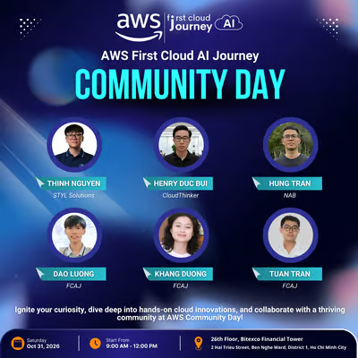
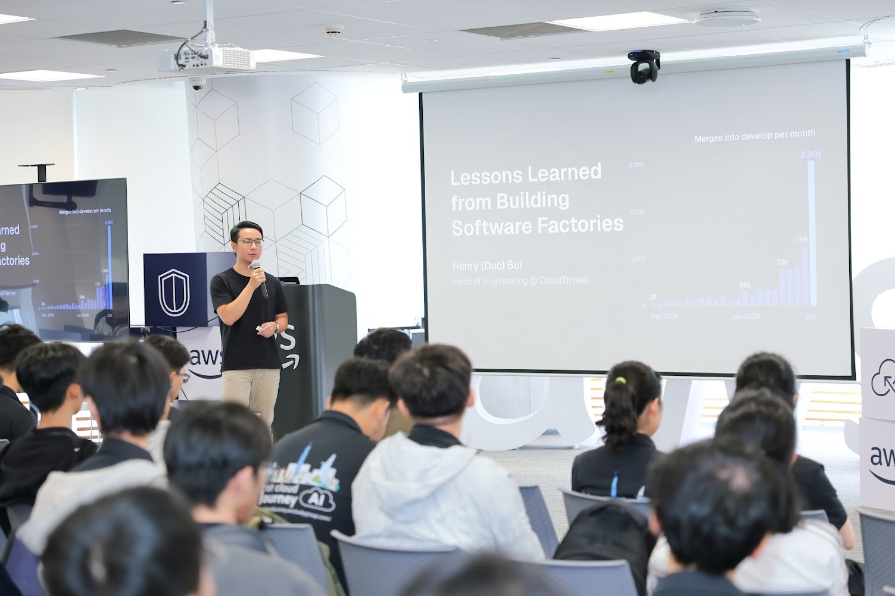
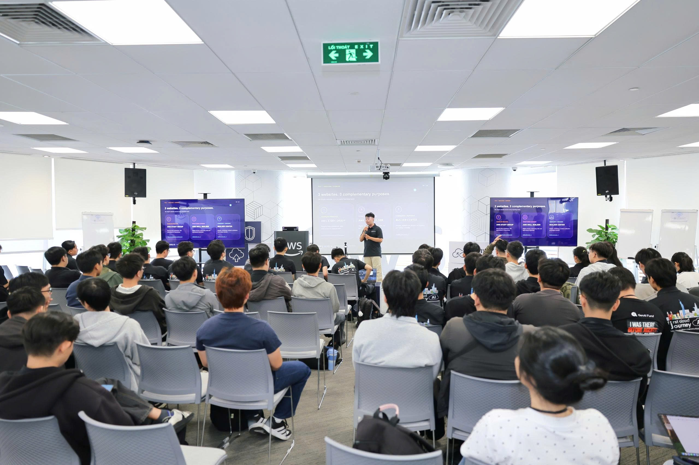
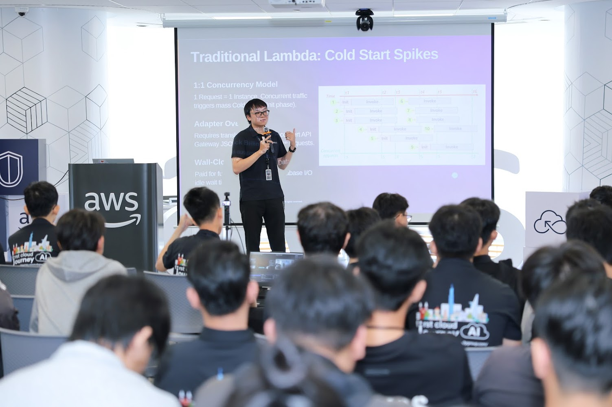
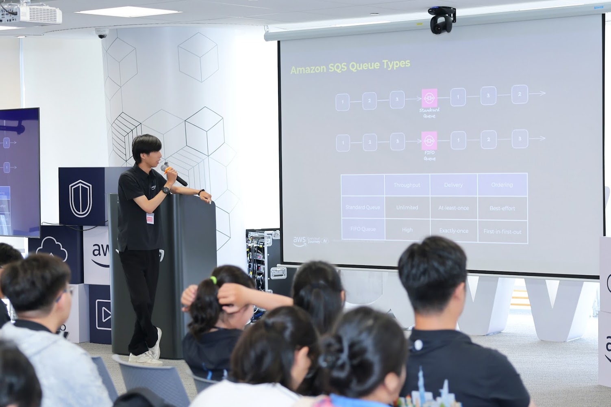
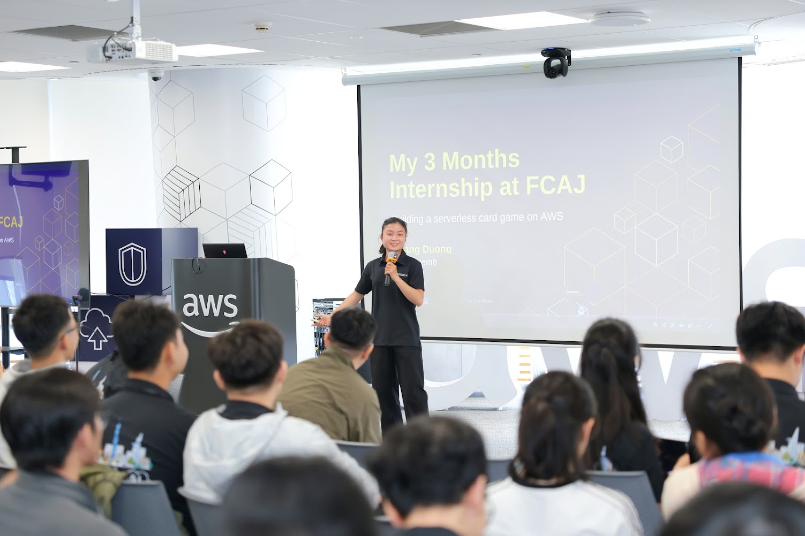
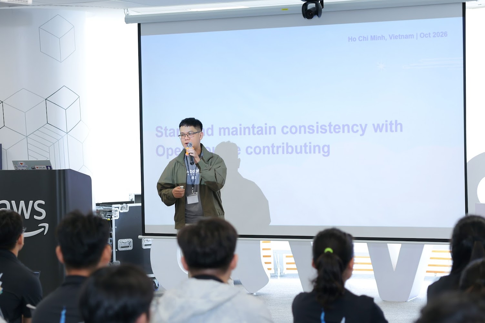
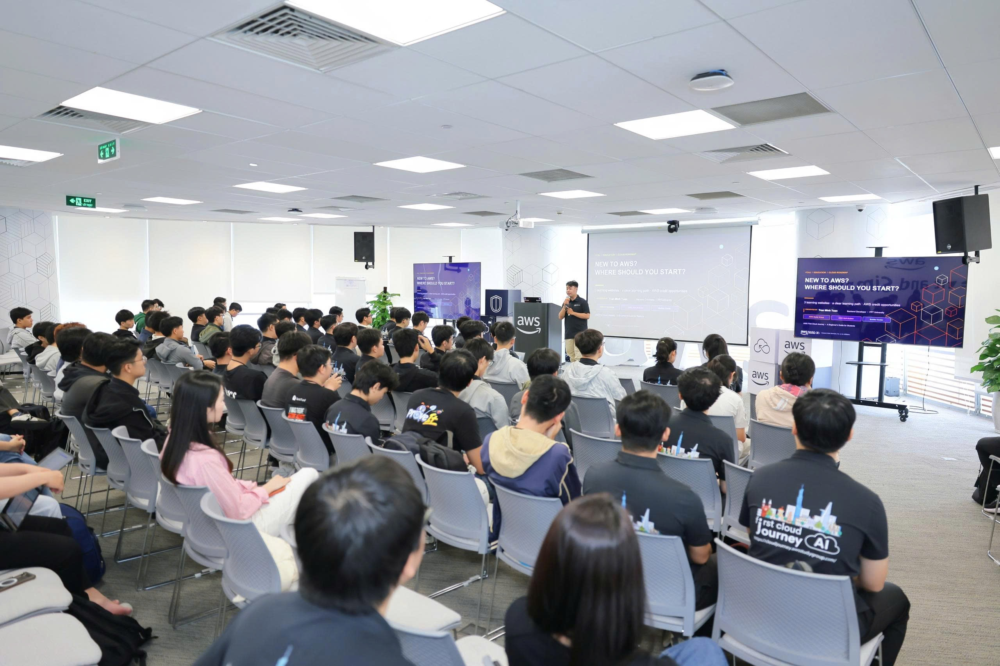
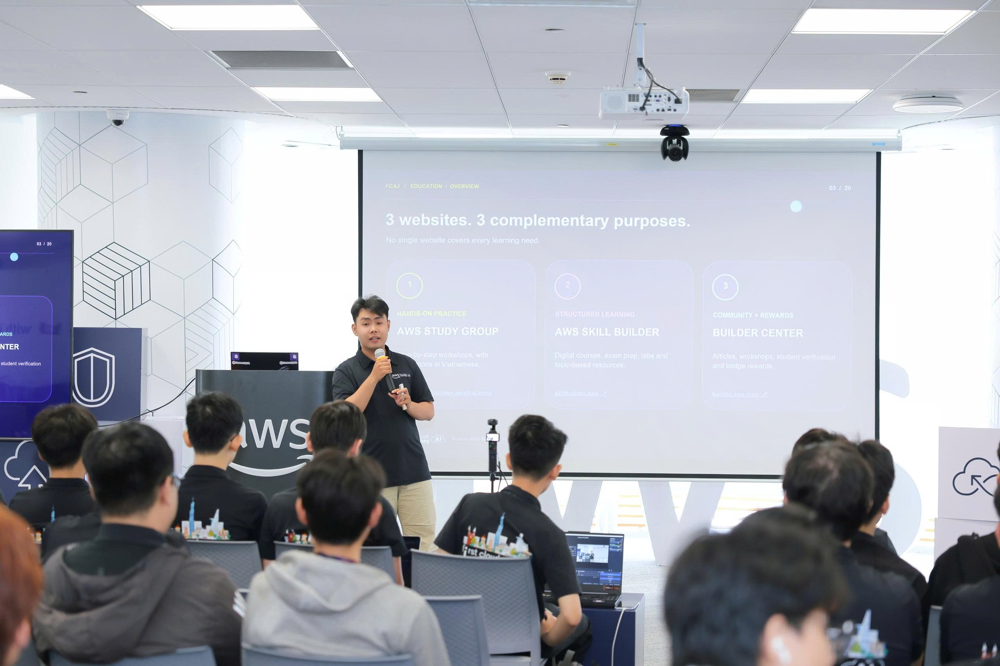

# FCAJ Community Day

- **Date** · Saturday, October 31, 2026
- **Time** · 09:00–12:00 (UTC+7)
- **Venue** · 26th floor, Bitexco Financial Tower, 02 Hai Trieu Street, Ho Chi Minh City
- **Organizer** · AWS First Cloud AI Journey (FCAJ)
- **My role** · In-person attendee
- **Key focus** · Learning paths for AWS beginners, serverless web architectures, and asynchronous systems with Amazon SQS

<figure>
  
  <figcaption>FCAJ Community Day event poster.</figcaption>
</figure>

### Event objectives

FCAJ Community Day brought students and practitioners together for six talks. The morning covered software delivery, AWS learning, serverless web architecture, asynchronous processing with Amazon SQS, internship experience, and open source contribution. I attended in person, engaging with the speakers and understanding how to structure learning resources effectively for practical projects. [FCAJ Community Day agenda](https://luma.com/1izeyind)

### Speakers

| Speaker on the poster | Organization |
| --- | --- |
| Thinh Nguyen | STYL Solutions |
| Henry Duc Bui | CloudThinker |
| Hung Tran | NAB |
| Dao Luong | FCAJ |
| Khang Duong | FCAJ |
| **Tuan Tran (Tran Minh Tuan)** | **FCAJ · Education session speaker** |

### Morning schedule

| Time (UTC+7) | Session | Focus |
| --- | --- | --- |
| 09:00–09:25 | Lessons Learned from Building Software Factories | Lessons from organizing software delivery at scale. |
| **09:30–09:55** | **Education · New to AWS? Where Should You Start?** | Presentation by teammate Tran Minh Tuan on beginning with AWS and selecting appropriate resources. |
| 10:00–10:25 | AWS Lambda Web Functions: Rethinking Serverless Web Architecture | Native HTTP, concurrent request processing, and evaluating performance and cost. |
| 10:30–11:00 | Amazon SQS: Building Asynchronous Systems | Decoupling producers and workers with queues, and comparing Standard and FIFO. |
| 11:00–11:25 | My 3-Month AWS Internship Journey | An FCAJ internship and a serverless card game project. |
| 11:30–12:00 | Start &amp; Maintain Consistency with Open Source Contributing | Making a first contribution and developing a consistent contribution habit. |

### Key highlights

#### Lessons Learned from Building Software Factories

**Henry Duc Bui**, Head of Engineering at **CloudThinker**, shared lessons from applying AI-DLC to the team's software development process. He showed a monthly chart of merges into the develop branch as an example of how the team tracked its workflow. For me, a metric like this raises follow-up questions about review time, what kinds of changes are merged, and how the team assesses quality. [Henry Duc Bui's session introduction](https://vn.linkedin.com/posts/bmd1905_trong-su%E1%BB%91t-6-th%C3%A1ng-qua-team-cloudthinker-activity-7521451084012417024-iN26)

<figure>
  
  <figcaption>Opening talk on CloudThinker's experience building software factories.</figcaption>
</figure>

#### Education session · New to AWS? Where Should You Start?

In the **Education** session, speaker Tran Minh Tuan opened with a question about where to start when there are many places to learn AWS. He introduced three resources by the purpose each one serves. As an attendee, I found this breakdown particularly actionable for choosing the next learning step—whether studying core concepts, completing a guided workshop, or exploring community use cases.

| Resource | What I introduced |
| --- | --- |
| **AWS Study Group** | Step-by-step workshops, including Vietnamese materials, for practicing how to configure and check AWS resources. |
| **AWS Skill Builder** | Topic-based courses, labs, and certification preparation for structured learning. |
| **AWS Builder Center** | Community articles and workshops, student activities, and badge opportunities subject to the relevant program requirements. |

[AWS Skill Builder](https://aws.amazon.com/training/digital/) · [AWS Builder Center](https://builder.aws.com/)

<figure>
  
  <figcaption>My explanation of the purpose of each AWS learning resource.</figcaption>
</figure>

I used these resources to connect classroom learning with engineering work. A student can learn a concept in a module, verify it with a small lab, and capture the result in a diagram, a screenshot, or a short explanation. When the concept comes up in a project, that record helps explain which service was chosen, how it was tested, and what could be done differently next time.

The talk also mentioned opportunities to explore **AWS credits**. For a new learner, that is a reason to check the eligibility conditions and get into the habit of tracking costs during the first labs.

#### AWS Lambda Web Functions and serverless web architecture

The session covered running an application as a **native HTTP server** on Lambda Web Functions. An application can use a supported Node.js web framework without an adapter specific to Lambda event payloads. A single execution environment can handle multiple requests at the same time. **128 requests** is the maximum configurable concurrency per environment. Lambda adjusts the actual limit based on resource usage and load. [Lambda Web Functions](https://docs.aws.amazon.com/lambda/latest/dg/web-functions.html) · [Scaling behavior](https://docs.aws.amazon.com/lambda/latest/dg/web-functions-scaling.html)

The session discussed **Active CPU Billing** and used live benchmarks to compare this model with container-based applications on EC2 and ECS. Web Functions charges include requests, active CPU time, memory over the environment's lifetime, and data transfer. When interpreting a benchmark, I would compare the shape of the workload, initialization latency, and how much time requests spend waiting for I/O. [Execution and billing model](https://docs.aws.amazon.com/lambda/latest/dg/web-functions.html)

<figure>
  
  <figcaption>The talk compared how Lambda handles concurrent traffic.</figcaption>
</figure>

#### Amazon SQS and asynchronous processing

The **Amazon SQS** session showed how a queue separates a producer from a worker. The producer can finish accepting the request, while workers process queued messages at a rate the downstream system can handle. The two sides can scale more independently as the amount of work changes.

The diagram at the venue compared **Standard** and **FIFO** queues. Standard queues deliver at least once and can deliver out of order. FIFO preserves order within a message group and supports send deduplication. A useful test is to see whether a worker can receive the same job again without repeating a write or changing the job to an incorrect state. [SQS Standard](https://docs.aws.amazon.com/AWSSimpleQueueService/latest/SQSDeveloperGuide/standard-queues.html) · [SQS FIFO](https://docs.aws.amazon.com/AWSSimpleQueueService/latest/SQSDeveloperGuide/sqs-fifo-queues.html)

<figure>
  
  <figcaption>Comparing delivery behavior and message ordering for the two queue types.</figcaption>
</figure>

#### My 3-Month AWS Internship Journey

**Khang Duong** described a three-month internship at FCAJ through the example of building a serverless card game on AWS. The talk connected learning individual services to using them in a project. For students preparing for an internship, it showed one way to explain the experience through implementation steps and lessons from the work.

<figure>
  
  <figcaption>The internship talk connected AWS services with project work.</figcaption>
</figure>

#### Starting and sustaining open source contributions

The last session covered finding a first contribution and continuing once the workflow becomes familiar. A small change such as improving a guide or clarifying an issue can teach a newcomer how to read project conventions, communicate with maintainers, and respond to review. My takeaway was to treat each contribution as an example of a problem I investigated and a result I improved.

<figure>
  
  <figcaption>Closing session on developing a consistent open source contribution habit.</figcaption>
</figure>

### What I learned as a speaker

- **Start with the audience's question.** For a student new to AWS, asking where to start leads to a concrete action, such as choosing a topic and using a lab to check their understanding.
- **Explain the purpose before introducing the tool.** Presenting each learning resource through a specific need makes it easier to remember when to use it.
- **Use examples and evidence when describing what I learned.** I can explain a lab or project through its original requirement, what I did, what I observed, and what still needs testing.

### Applying the ideas to work

The SQS session relates to the document-processing flow in the [Tindy proposal](/2-proposal/). One test can deliver a PDF scan event more than once and check that the worker updates the document status consistently. I can keep the result with the flow diagram so that the queue's role is easy to explain when presenting the project.

### Event photos

<figure>
  
  <figcaption>Opening my talk at FCAJ Community Day.</figcaption>
</figure>

<figure>
  
  <figcaption>Presenting a path from structured learning to practice and community participation.</figcaption>
</figure>
