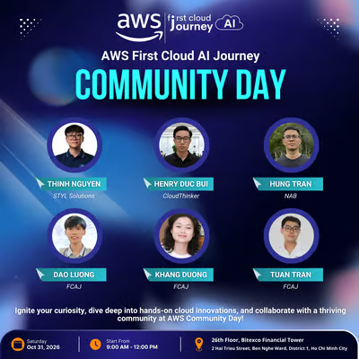
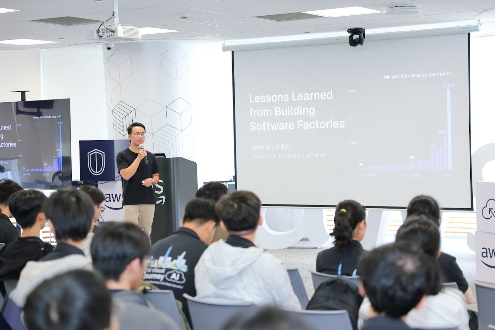
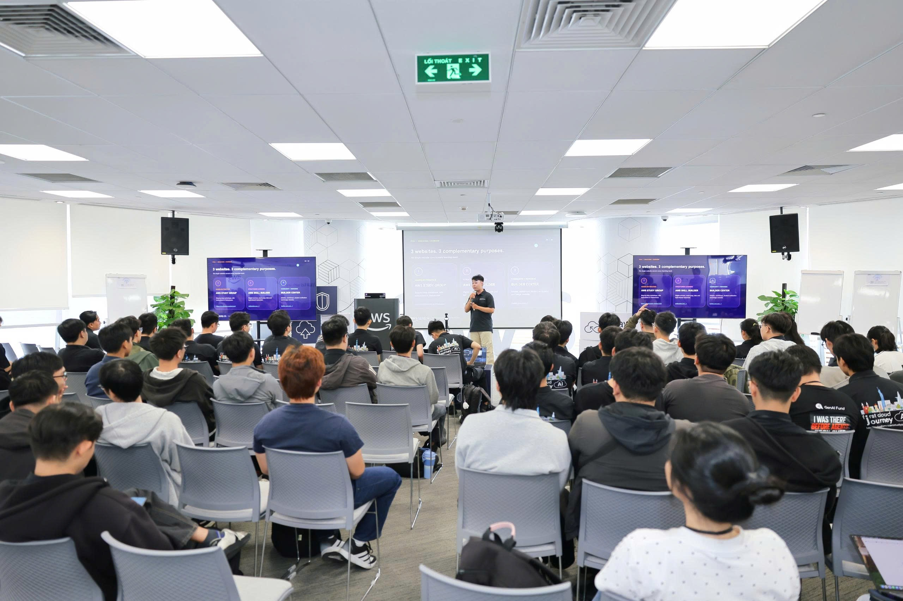
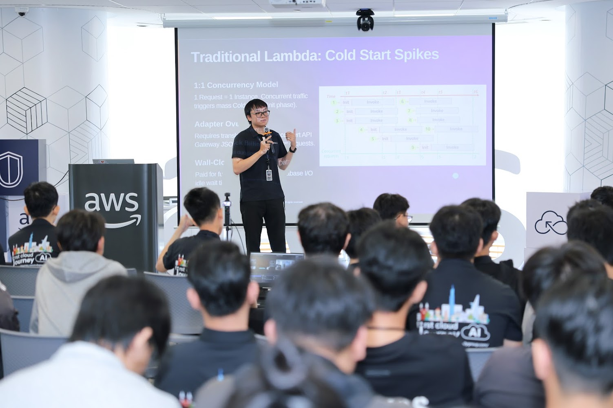
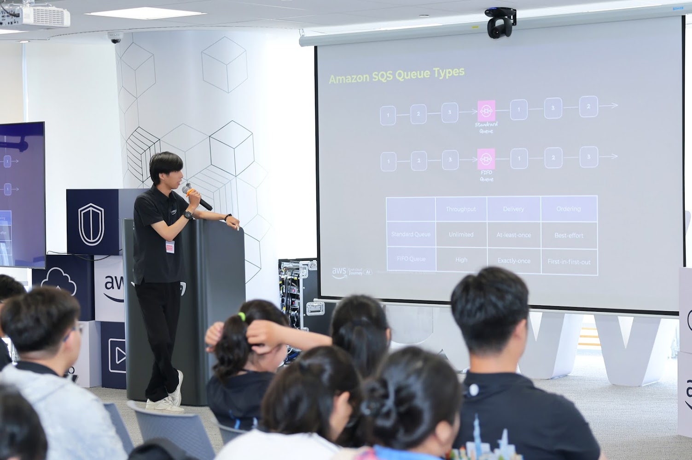
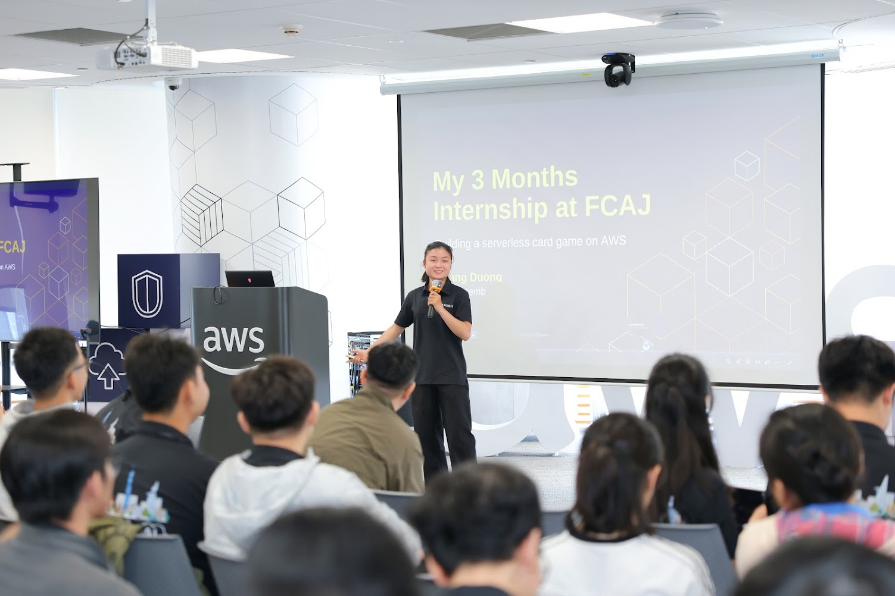
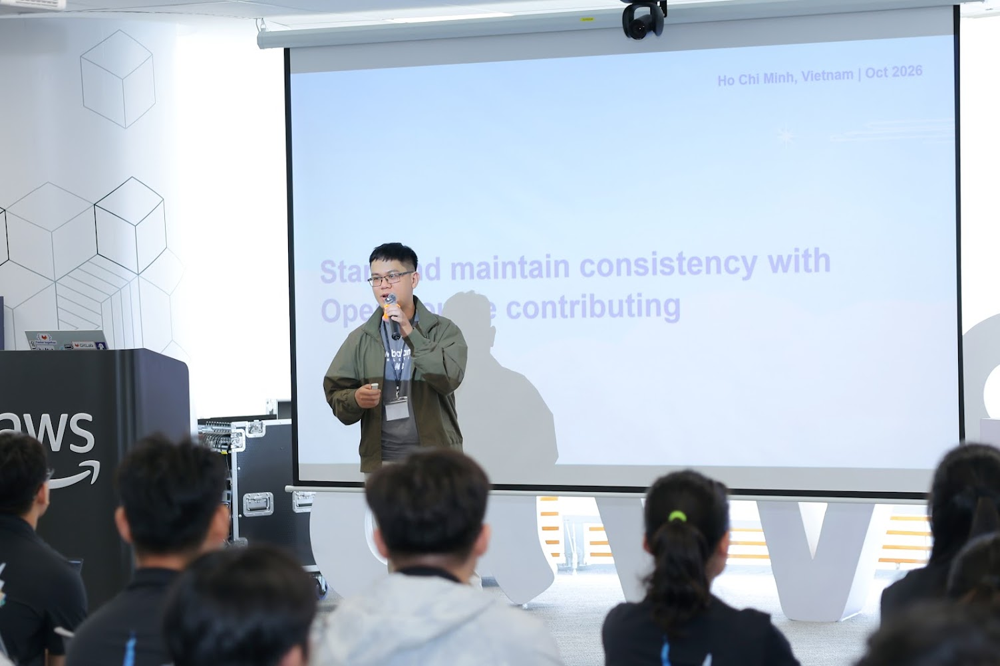
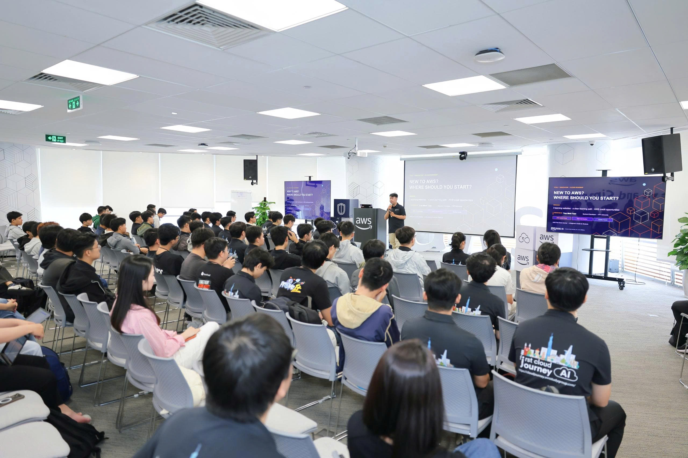
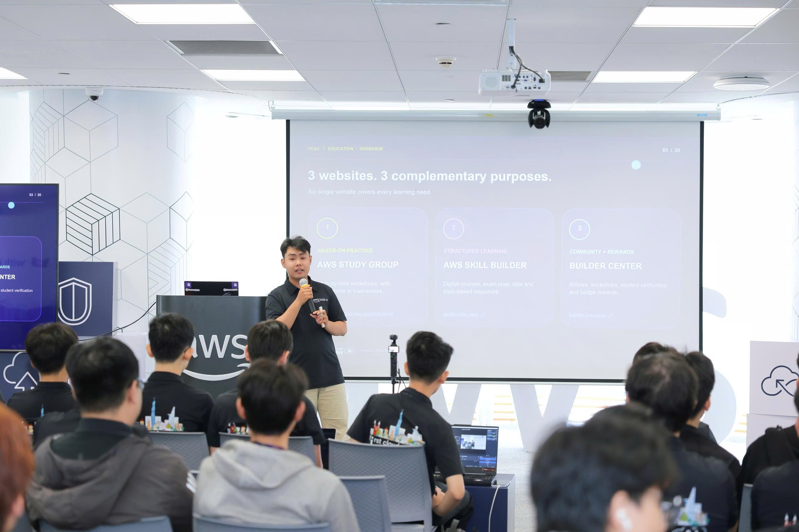

# FCAJ Community Day

- **Ngày tổ chức** · Thứ Bảy, 31/10/2026
- **Thời gian** · 09:00–12:00 (UTC+7)
- **Địa điểm** · Tầng 26, Bitexco Financial Tower, 02 Hải Triều, TP.HCM
- **Đơn vị tổ chức** · AWS First Cloud AI Journey (FCAJ)
- **Vai trò của em** · Người tham dự trực tiếp
- **Mối quan tâm chính** · Theo dõi các phiên chia sẻ về lộ trình học AWS, Lambda Web Functions và kiến trúc bất đồng bộ với Amazon SQS

<figure>
  
  <figcaption>Poster chương trình FCAJ Community Day.</figcaption>
</figure>

### Mục đích của sự kiện

FCAJ Community Day kết nối người làm kỹ thuật và sinh viên qua sáu phiên chia sẻ. Chương trình buổi sáng gồm kinh nghiệm xây dựng quy trình phát triển phần mềm, cách học AWS, kiến trúc web serverless, xử lý bất đồng bộ với Amazon SQS, trải nghiệm thực tập và đóng góp mã nguồn mở. Em tham gia với vai trò người tham dự, lắng nghe các diễn giả chia sẻ cách chọn tài nguyên học tập và áp dụng AWS vào các dự án thực tế. [Chương trình FCAJ Community Day](https://luma.com/1izeyind)

### Diễn giả

| Diễn giả trên poster | Đơn vị |
| --- | --- |
| Thinh Nguyen | STYL Solutions |
| Henry Duc Bui | CloudThinker |
| Hung Tran | NAB |
| Dao Luong | FCAJ |
| Khang Duong | FCAJ |
| **Tuan Tran (Trần Minh Tuấn)** | **FCAJ · Diễn giả phiên Education** |

### Lịch trình buổi sáng

| Giờ (UTC+7) | Phiên | Nội dung |
| --- | --- | --- |
| 09:00–09:25 | Lessons Learned from Building Software Factories | Kinh nghiệm tổ chức quy trình phát triển phần mềm ở quy mô lớn và những bài học từ thực tế. |
| **09:30–09:55** | **Education · New to AWS? Where Should You Start?** | Phần chia sẻ của bạn Trần Minh Tuấn về cách bắt đầu học AWS và chọn tài nguyên phù hợp với từng mục tiêu. |
| 10:00–10:25 | AWS Lambda Web Functions: Rethinking Serverless Web Architecture | HTTP native, xử lý nhiều request đồng thời và cách đánh giá hiệu năng, chi phí. |
| 10:30–11:00 | Amazon SQS: Building Asynchronous Systems | Tách bên gửi và bên xử lý bằng hàng đợi, so sánh Standard với FIFO. |
| 11:00–11:25 | My 3-Month AWS Internship Journey | Kinh nghiệm thực tập tại FCAJ qua dự án trò chơi thẻ bài serverless. |
| 11:30–12:00 | Start &amp; Maintain Consistency with Open Source Contributing | Bắt đầu đóng góp vào dự án mã nguồn mở và duy trì thói quen đóng góp. |

### Nội dung nổi bật

#### Lessons Learned from Building Software Factories

**Henry Duc Bui**, Head of Engineering tại **CloudThinker**, chia sẻ những bài học từ quá trình nhóm áp dụng AI-DLC vào phát triển phần mềm. Phần trình bày đưa ra biểu đồ số lượt merge vào nhánh develop theo tháng như một ví dụ về cách theo dõi thay đổi trong quy trình. Khi nhìn vào một chỉ số như vậy, em có thể đặt câu hỏi thêm về thời gian review, loại thay đổi được merge và cách nhóm theo dõi chất lượng. [Giới thiệu phiên chia sẻ của Henry Duc Bui](https://vn.linkedin.com/posts/bmd1905_trong-su%E1%BB%91t-6-th%C3%A1ng-qua-team-cloudthinker-activity-7521451084012417024-iN26)

<figure>
  
  <figcaption>Phiên mở đầu về kinh nghiệm xây dựng software factories tại CloudThinker.</figcaption>
</figure>

#### Phiên Education · New to AWS? Where Should You Start?

Trong phiên **Education**, diễn giả Trần Minh Tuấn mở đầu bằng câu hỏi người mới nên bắt đầu từ đâu khi có nhiều nguồn học AWS, đồng thời giới thiệu ba nền tảng theo mục đích sử dụng của từng nguồn. Em thấy cách trình bày này rất hữu ích, giúp người nghe như em định hướng rõ ràng việc cần làm tiếp theo, chẳng hạn học khái niệm nền tảng, thực hành một workshop cụ thể hoặc tìm hiểu cách cộng đồng áp dụng dịch vụ đó vào dự án.

| Nguồn học | Nội dung em giới thiệu |
| --- | --- |
| **AWS Study Group** | Workshop thực hành theo từng bước, có tài liệu tiếng Việt để người mới làm quen với cách cấu hình và kiểm tra tài nguyên AWS. |
| **AWS Skill Builder** | Khóa học theo chủ đề, lab và tài nguyên ôn chứng chỉ để xây kiến thức theo lộ trình. |
| **AWS Builder Center** | Bài viết và workshop của cộng đồng, hoạt động dành cho sinh viên và các chương trình huy hiệu theo điều kiện của từng hoạt động. |

[AWS Skill Builder](https://aws.amazon.com/training/digital/) · [AWS Builder Center](https://builder.aws.com/)

<figure>
  
  <figcaption>Phần em giới thiệu mục đích của từng nguồn học AWS.</figcaption>
</figure>

Em dùng ba nguồn học để nối việc học ở trường với công việc kỹ thuật. Một khái niệm có thể được học theo module, kiểm tra qua một lab nhỏ rồi ghi lại bằng một sơ đồ, ảnh kết quả hoặc vài dòng giải thích. Khi mang kiến thức đó vào dự án, sinh viên có thể trình bày vì sao chọn một dịch vụ, cách đã thử và điều gì sẽ làm khác nếu gặp lại bài toán.

Phần trình bày cũng nhắc đến cơ hội tìm hiểu **AWS credits**. Với người mới, đây là dịp để hỏi thêm về điều kiện tham gia và tập thói quen theo dõi chi phí ngay từ các bài lab đầu tiên.

#### AWS Lambda Web Functions và kiến trúc web serverless

Phiên này giới thiệu cách một ứng dụng web chạy như **HTTP server trực tiếp** trên Lambda Web Functions. Ứng dụng có thể dùng các framework Node.js được hỗ trợ mà không cần lớp adapter riêng cho định dạng sự kiện Lambda. Một môi trường thực thi có thể nhận nhiều request cùng lúc. **128 request** là giới hạn trên có thể cấu hình cho mỗi môi trường, còn mức thực tế do Lambda điều chỉnh theo tải và tài nguyên được sử dụng. [Lambda Web Functions](https://docs.aws.amazon.com/lambda/latest/dg/web-functions.html) · [Cách Lambda điều chỉnh concurrency](https://docs.aws.amazon.com/lambda/latest/dg/web-functions-scaling.html)

Phần trình bày đề cập **Active CPU Billing** và đối chiếu với cách chạy ứng dụng bằng Docker trên EC2 hoặc ECS qua benchmark tại sự kiện. Chi phí của Web Functions gồm số request, CPU đang hoạt động, bộ nhớ theo vòng đời môi trường và truyền dữ liệu. Khi xem benchmark, em ghi lại những yếu tố cần so sánh như loại workload, độ trễ khởi tạo và tỷ lệ thời gian ứng dụng chờ I/O. [Mô hình thực thi và tính phí](https://docs.aws.amazon.com/lambda/latest/dg/web-functions.html)

<figure>
  
  <figcaption>Phần so sánh cách Lambda xử lý lưu lượng đồng thời.</figcaption>
</figure>

#### Amazon SQS và xử lý bất đồng bộ

Phiên **Amazon SQS** minh họa cách đặt hàng đợi giữa bên gửi yêu cầu và worker. Bên gửi có thể hoàn tất bước tiếp nhận yêu cầu, còn worker xử lý theo tốc độ phù hợp với năng lực của hệ thống phía sau. Cách tổ chức này giúp hai phía thay đổi quy mô độc lập hơn khi lượng việc tăng.

Ảnh tại hội trường minh họa **Standard Queue** và **FIFO Queue**. Standard giao thông điệp ít nhất một lần và có thể giao lệch thứ tự. FIFO giữ thứ tự trong từng nhóm thông điệp và hỗ trợ chống gửi trùng. Với một worker, điều em cần kiểm tra là cùng một công việc được nhận lại có làm lặp thao tác ghi hoặc làm sai trạng thái hay không. [SQS Standard](https://docs.aws.amazon.com/AWSSimpleQueueService/latest/SQSDeveloperGuide/standard-queues.html) · [SQS FIFO](https://docs.aws.amazon.com/AWSSimpleQueueService/latest/SQSDeveloperGuide/sqs-fifo-queues.html)

<figure>
  
  <figcaption>So sánh đặc điểm phân phối và thứ tự thông điệp của hai loại hàng đợi.</figcaption>
</figure>

#### My 3-Month AWS Internship Journey

**Khang Duong** chia sẻ hành trình ba tháng thực tập tại FCAJ qua ví dụ xây dựng trò chơi thẻ bài serverless trên AWS. Câu chuyện đi từ phần học dịch vụ đến cách dùng chúng trong một dự án thực tế. Đây là một góc nhìn gần với người nghe đang chuẩn bị thực tập vì phần trình bày cho thấy công việc có thể được kể qua từng bước triển khai và những bài học đã rút ra.

<figure>
  
  <figcaption>Phiên chia sẻ trải nghiệm thực tập và ứng dụng AWS vào dự án.</figcaption>
</figure>

#### Bắt đầu và duy trì đóng góp mã nguồn mở

Phiên cuối nói về cách tìm một đóng góp đầu tiên và cách tiếp tục sau khi đã làm quen với quy trình. Một việc nhỏ như bổ sung hướng dẫn hoặc làm rõ một issue có thể giúp người mới học cách đọc quy ước dự án, trao đổi với maintainer và phản hồi review. Phần em ghi nhớ là có thể dùng mỗi đóng góp như một ví dụ cụ thể về vấn đề đã tìm hiểu và kết quả đã cải thiện.

<figure>
  
  <figcaption>Phiên cuối về cách xây dựng thói quen đóng góp mã nguồn mở.</figcaption>
</figure>

### Những gì em học được khi làm diễn giả

- **Bắt đầu từ câu hỏi của người nghe.** Với sinh viên mới học AWS, câu hỏi nên học từ đâu dẫn tới một việc cụ thể hơn, chẳng hạn chọn một chủ đề và tìm bài thực hành để kiểm tra kiến thức.
- **Giải thích mục đích trước khi giới thiệu công cụ.** Việc giới thiệu mỗi trang học qua một nhu cầu giúp người nghe nhớ khi nào nên dùng công cụ đó.
- **Dùng ví dụ và bằng chứng để kể lại quá trình học.** Khi trình bày một lab hoặc dự án, em có thể mô tả yêu cầu ban đầu, việc đã làm, kết quả và điều còn cần thử tiếp.

### Ứng dụng vào công việc

Phiên Amazon SQS giúp em liên hệ với luồng xử lý tài liệu trong [proposal Tindy](/vi/2-proposal/). Khi worker đọc lại sự kiện quét PDF, một ca kiểm thử có thể gửi lại thông điệp và kiểm tra trạng thái tài liệu có được cập nhật nhất quán. Em có thể ghi lại kết quả đó cùng sơ đồ luồng để giải thích mục đích của hàng đợi khi trình bày dự án.

### Hình ảnh tại sự kiện

<figure>
  
  <figcaption>Mở đầu phần chia sẻ của em tại hội trường.</figcaption>
</figure>

<figure>
  
  <figcaption>Phần trình bày về học theo lộ trình, thực hành và kết nối cộng đồng.</figcaption>
</figure>
