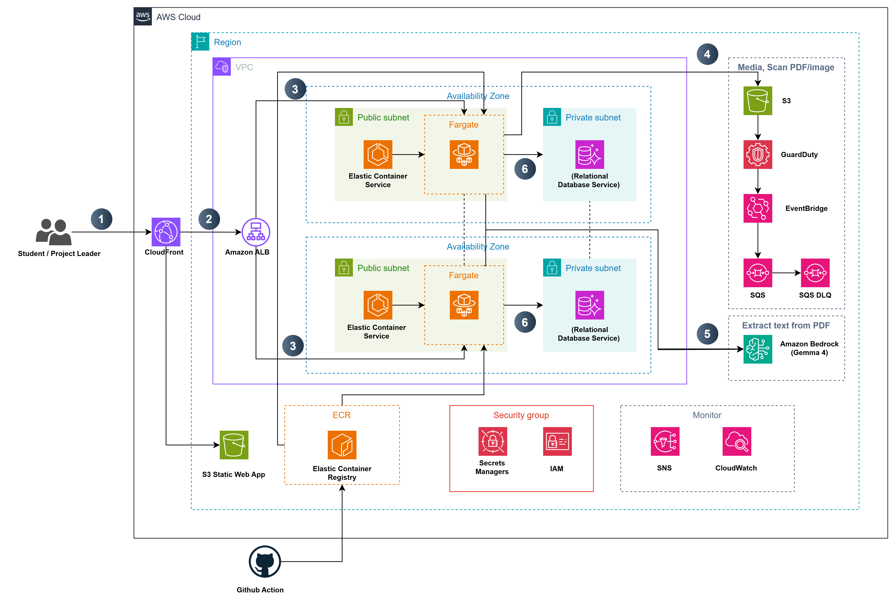

Tindy là ứng dụng tìm dự án và đồng đội, hỗ trợ hồ sơ cá nhân, ứng tuyển và giao tiếp giữa các thành viên. Workshop triển khai hạ tầng AWS phục vụ frontend, backend, database và luồng xử lý PDF bằng sáu template CloudFormation.

## Mục tiêu

Sau khi hoàn tất thực hành, người đọc có thể triển khai các stack theo phụ thuộc, dùng Outputs làm đầu vào cho stack tiếp theo, chuẩn bị database Fresh, chạy bootstrap/migration/seed và kiểm tra ứng dụng qua CloudFront. Phần demo dùng dữ liệu seed để minh họa đăng nhập, tìm dự án, ứng tuyển và xử lý đơn.

## Kiến trúc hệ thống

Sơ đồ thể hiện cách bố trí các nhóm dịch vụ và thành phần ứng dụng.

| Thành phần | Vai trò trong hệ thống |
| --- | --- |
| CloudFront và S3 frontend | Phục vụ frontend qua HTTPS, truy cập bucket qua Origin Access Control. |
| CloudFront VPC Origin và internal ALB | Chuyển request backend từ CloudFront đến ECS API trong VPC. |
| ECS Fargate | Chạy API và các one-off task chuẩn bị DB. |
| RDS PostgreSQL | Lưu dữ liệu ứng dụng, sử dụng private DB subnet và kết nối TLS. |
| S3 media | Lưu file upload trong các prefix của ứng dụng. |
| GuardDuty, EventBridge và SQS | Quét PDF, chuyển kết quả quét về worker của API, có DLQ cho message xử lý lỗi. |
| Secrets Manager và SSM | Lưu cấu hình bí mật và Data Protection keys theo cơ chế ứng dụng. |
| ECR và GitHub OIDC | Lưu image backend và hỗ trợ GitHub Actions xác thực với AWS. |
| CloudWatch và SNS | Thu thập log, theo dõi alarm và gửi cảnh báo email. |

## Sáu template CloudFormation

| Template | Nội dung |
| --- | --- |
| `foundation.yaml` | S3, ECR, application secrets, OIDC và các role triển khai/vận hành có điều kiện. |
| `network.yaml` | VPC, subnet, route và security group. |
| `database.yaml` | RDS instance, subnet group và parameter group. |
| `integrations.yaml` | GuardDuty plan, EventBridge rule, SQS/DLQ, SNS và alarm. |
| `edge.yaml` | CloudFront, Origin Access Control, frontend bucket policy và maintenance routing. |
| `runtime.yaml` | ECS, internal ALB, VPC Origin, IAM role và các task definition. |

## Luồng triển khai của lượt thực hành

1. Cleanup môi trường hiện tại, ghi ở mục 5.7.
2. Import tài nguyên Foundation được giữ rồi cập nhật về template chính, tạo Network ở mục 5.3.
3. Tạo Database Fresh và Integrations ở mục 5.4.
4. Tạo Edge maintenance để lấy hostname, tạo Runtime với DesiredCount 0, chuẩn bị DB và seed, sau đó bật API và chuyển Edge live ở mục 5.5.
5. Kiểm tra ứng dụng và video demo ở [mục 5.6](../5.6-Application-Demo/).

Phần thực hành chọn cùng tài khoản và Region `us-east-1`, dùng hostname CloudFront mới và dữ liệu demo được seed lại. Các mục triển khai được bổ sung bằng ảnh và kết quả đã xác minh theo tiến độ thực tế.
