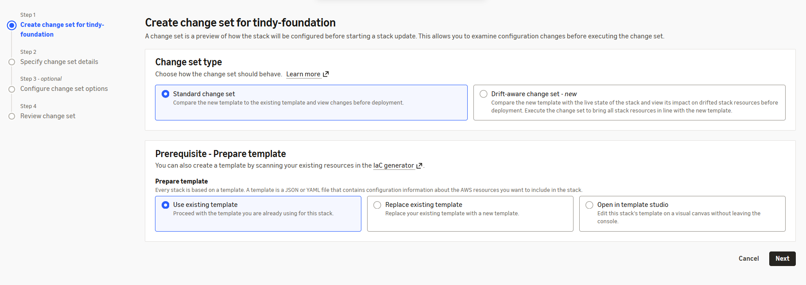
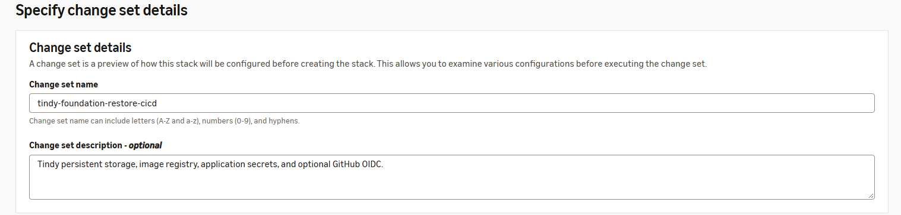
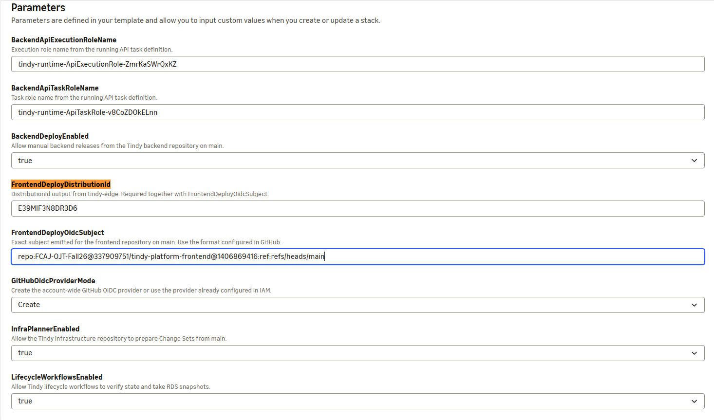
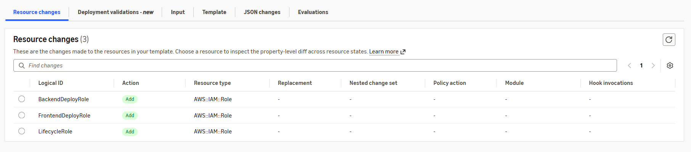
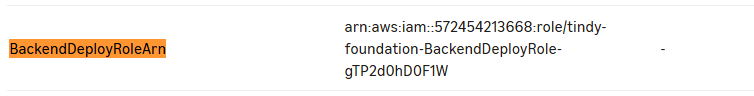
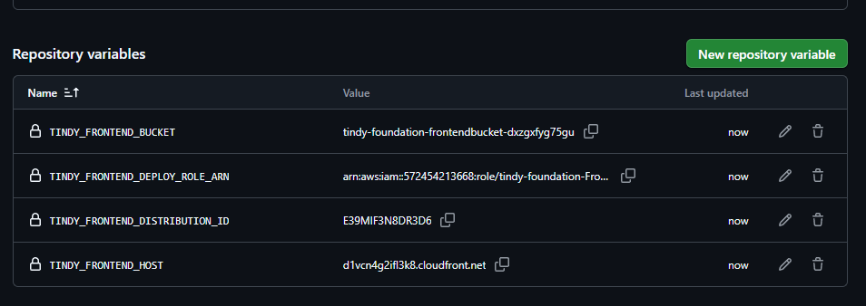
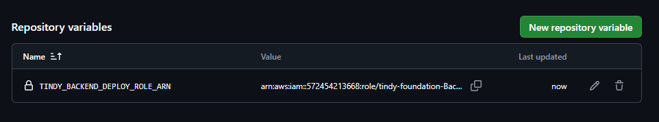
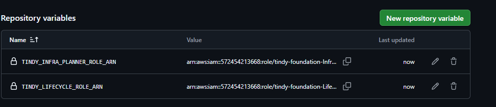
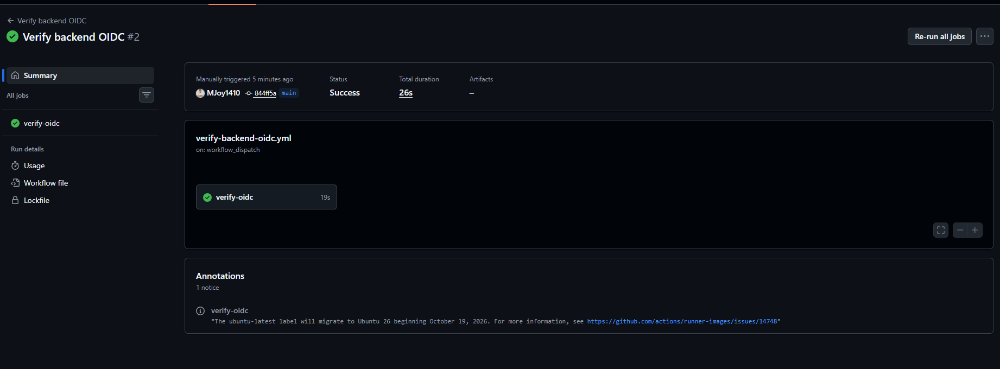
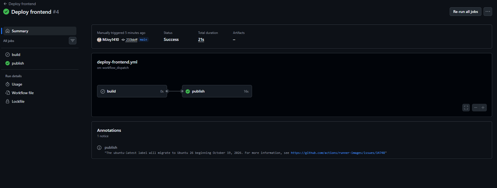

Đối chiếu read-only AWS cho thấy Foundation đã bật InfraPlannerEnabled, nhưng BackendDeployEnabled và LifecycleWorkflowsEnabled vẫn false, các đầu vào frontend deploy trống. Runtime mới tạo hai role API có tên mới. Cần khôi phục các role deploy bằng CloudFormation rồi cập nhật GitHub Actions repository variables. Các bước dưới đây chưa được thực thi.

## 1. Change Set Foundation

Vào CloudFormation → tindy-foundation → Create a change set, Standard, Use existing template. Tên `tindy-foundation-restore-cicd`.

| Tham số | Giá trị |
| --- | --- |
| `BackendDeployEnabled` | `true` |
| `BackendApiExecutionRoleName` | `tindy-runtime-ApiExecutionRole-ZmrKaSWrQxKZ` |
| `BackendApiTaskRoleName` | `tindy-runtime-ApiTaskRole-v8CoZDOkELnn` |
| `FrontendDeployDistributionId` | `E39MIF3N8DR3D6` |
| `FrontendDeployOidcSubject` | `repo:FCAJ-OJT-Fall26@337909751/tindy-platform-frontend@1406869416:ref:refs/heads/main` |
| `LifecycleWorkflowsEnabled` | `true` |

Frontend OIDC subject lấy từ backup stack-metadata trước cleanup, hai role API lấy từ Resources Runtime hiện tại. Giữ GitHubOidcProviderMode Create và InfraPlannerEnabled true như hiện tại. Backend role giới hạn iam:PassRole theo hai role API mới. Frontend role giới hạn quyền phát hành theo bucket và distribution. Lifecycle role phục vụ workflow xác minh trạng thái và snapshot theo template.

Giữ options, xác nhận IAM capability và tạo Change Set. Dự kiến thêm FrontendDeployRole, BackendDeployRole, LifecycleRole. **📸 Chụp Parameters và Resource changes khi CREATE_COMPLETE / AVAILABLE** để review. Sau Execute thành công, lấy ARN mới từ Outputs rồi cập nhật repository variables theo workflow. Chưa xác nhận role mới, GitHub variables hoặc workflow đã hoạt động.

## 2. Các repository variables cần đối chiếu sau cập nhật

| Repository | Variable | Nguồn |
| --- | --- | --- |
| Frontend | `TINDY_FRONTEND_DEPLOY_ROLE_ARN` | Foundation FrontendDeployRoleArn mới |
| Frontend | `TINDY_FRONTEND_BUCKET` | `tindy-foundation-frontendbucket-dxzgxfyg75gu` |
| Frontend | `TINDY_FRONTEND_DISTRIBUTION_ID` | `E39MIF3N8DR3D6` |
| Frontend | `TINDY_FRONTEND_HOST` | `d1vcn4g2ifl3k8.cloudfront.net` |
| Backend | `TINDY_BACKEND_DEPLOY_ROLE_ARN` | Foundation BackendDeployRoleArn mới |
| Infrastructure | `TINDY_INFRA_PLANNER_ROLE_ARN` | Foundation InfraPlannerRoleArn hiện tại |
| Infrastructure | `TINDY_LIFECYCLE_ROLE_ARN` | Foundation LifecycleRoleArn mới |

Các kịch bản kiểm thử giao diện và video demo được ghi nhận chi tiết tại [Mục 5.6 — Kiểm tra ứng dụng và video demo](../../5.6-Application-Demo/).

## 3. Bằng chứng cấu hình Change Set CI/CD

Đã chọn Standard change set và Use existing template trên `tindy-foundation`, tên `tindy-foundation-restore-cicd`.

Ảnh Parameters khớp bảng hướng dẫn: BackendDeployEnabled true, hai role API mới, distribution `E39MIF3N8DR3D6`, frontend OIDC subject đã đối chiếu backup và LifecycleWorkflowsEnabled true. GitHubOidcProviderMode tiếp tục Create và InfraPlannerEnabled true.

Các giá trị này khôi phục quyền GitHub Actions theo tài nguyên mới. Đây là cấu hình OIDC cho CI/CD. Các bước cấu hình đăng nhập người dùng bằng OAuth không thuộc nội dung workshop.

Tiếp tục Next, giữ options, xác nhận IAM capability và tạo Change Set. **📸 Chụp Resource changes khi CREATE_COMPLETE / AVAILABLE**. Dự kiến Add `FrontendDeployRole`, `BackendDeployRole`, `LifecycleRole`. Chưa có bằng chứng Change Set hoàn tất hoặc role mới đã được tạo tại mốc này.

## 4. Review ba role CI/CD

Ảnh Resource changes xác nhận đúng ba mục **Add**, resource type `AWS::IAM::Role`:

| Logical ID | Chức năng |
| --- | --- |
| `BackendDeployRole` | Phát hành image API và cập nhật ECS, PassRole theo hai role API đã cấu hình. |
| `FrontendDeployRole` | Phát hành frontend lên bucket và invalidate distribution đã cấu hình. |
| `LifecycleRole` | Phục vụ workflow xác minh trạng thái và tạo snapshot theo quyền trong template. |

Danh sách khớp phạm vi khôi phục quyền CI/CD. Ảnh chỉ hiển thị Resource changes, không có phần Overview xác nhận trạng thái Change Set. Trên Console, kiểm tra **CREATE_COMPLETE / AVAILABLE**, rồi bấm Execute change set, giữ rollback và Use deletion policy nếu được hỏi. Chờ Foundation **UPDATE_COMPLETE**.

**📸 Chụp trạng thái stack và Outputs**, gồm `FrontendDeployRoleArn`, `BackendDeployRoleArn`, `LifecycleRoleArn`, `InfraPlannerRoleArn`. Dùng ARN thực tế sau cập nhật cho repository variables. Chưa xác nhận role đã được tạo hoặc GitHub variables đã cập nhật tại mốc này.

## 5. Foundation hoàn tất và ARN đã xác minh

Ảnh Outputs có đủ bốn role. Đối chiếu read-only AWS CLI xác nhận Foundation **UPDATE_COMPLETE** và các ARN sau:

| Output | ARN |
| --- | --- |
| FrontendDeployRoleArn | `arn:aws:iam::572454213668:role/tindy-foundation-FrontendDeployRole-3fN15Svzx4RJ` |
| BackendDeployRoleArn | `arn:aws:iam::572454213668:role/tindy-foundation-BackendDeployRole-gTP2d0hD0F1W` |
| LifecycleRoleArn | `arn:aws:iam::572454213668:role/tindy-foundation-LifecycleRole-VTyUOZ4hpsjt` |
| InfraPlannerRoleArn | `arn:aws:iam::572454213668:role/tindy-foundation-InfraPlannerRole-xhQ3LjfCL4Xt` |

## 6. Cập nhật GitHub repository variables

Trong từng repository, mở **Settings → Secrets and variables → Actions → Variables → Repository variables**. Sửa biến đã có hoặc tạo nếu thiếu, dùng tên và nguồn trong bảng mục 2. Role frontend/backend/lifecycle dùng ARN mới ở trên, planner dùng ARN hiện tại đã xác minh. Frontend bucket, distribution ID và host dùng giá trị ở mục 2. Không thêm giao thức vào TINDY_FRONTEND_HOST.

**📸 Chụp danh sách variables sau lưu trong ba repository.** Đây là repository variables phục vụ GitHub Actions, không phải application secrets. Chưa có bằng chứng đã cập nhật GitHub hoặc workflow đã xác thực OIDC thành công tại mốc này. Các flow demo giao diện còn lại để quay video sau.

## 7. Repository variables đã ghi nhận

Frontend có đủ bốn biến. Giá trị bucket, distribution ID và hostname hiển thị khớp hướng dẫn. Backend có biến role deploy. Infrastructure có biến planner và lifecycle. Các hàng ghi nhận vừa cập nhật, nhưng giá trị ARN bị rút gọn trong ảnh nên chưa xác nhận toàn bộ ARN từ ảnh này.

## 8. Kiểm tra federation bằng workflow hiện có

Mã workflow local có hai chế độ kiểm tra phù hợp. Trong repo backend, mở **Actions → Verify backend OIDC → Run workflow**, chọn branch **main**. Workflow kiểm tra biến role, assume role bằng OIDC và đối chiếu STS identity, không triển khai API.

Trong repo frontend, mở **Actions → Deploy frontend → Run workflow**, chọn **main**, mode **verify-oidc**, release_sha để trống. Chế độ này kiểm tra federation, không chọn deploy tại bước này.

**📸 Chụp hai workflow run thành công và bước xác minh identity.** Nếu workflow trên GitHub khác bản local, đối chiếu nội dung trước khi chạy. Chưa có bằng chứng workflow đã chạy hoặc frontend/backend federation đã đạt. Planner và lifecycle cũng chưa được xác minh bằng run tại mốc này.

## 9. Kết quả workflow xác minh CI/CD

**Verify backend OIDC #2** trên main, commit rút gọn `844ff5a`, đạt **Success**, tổng thời gian 26 giây, job verify-oidc thành công. Theo mã workflow đã đối chiếu, job kiểm tra biến, assume role qua OIDC và đối chiếu STS identity. Ảnh Summary ghi nhận kết quả run, chưa có ảnh log riêng của identity.

**Deploy frontend #4** trên main, commit rút gọn `233bbff`, đạt **Success**, tổng thời gian 21 giây. Build skipped, publish thành công, khớp chế độ verify-oidc đã hướng dẫn. Đây là kiểm tra federation, không ghi nhận phát hành frontend mới.

Hai ảnh có notice về thay đổi runner ubuntu-latest, các workflow vẫn Success. Frontend/backend federation đã đạt theo kết quả run. Chưa thực hiện backend release, frontend deploy thực tế hoặc run planner/lifecycle sau redeploy. Các flow demo còn lại sẽ được kiểm tra khi quay video theo kế hoạch của người thực hiện.
