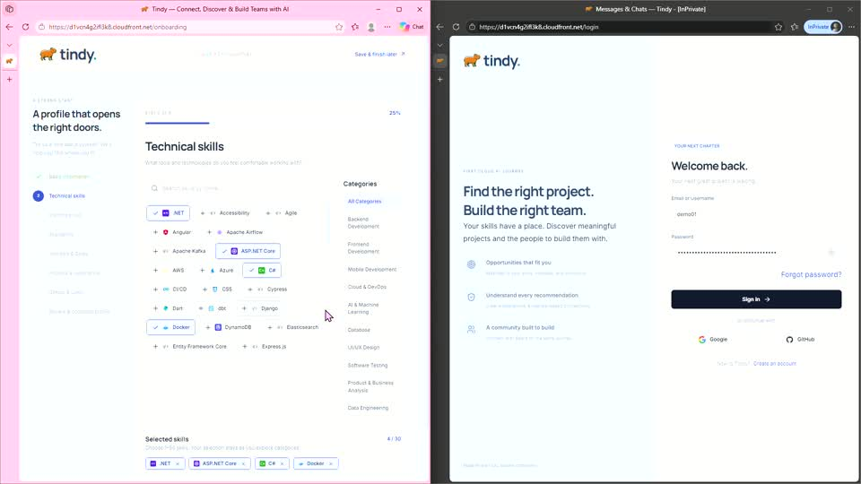
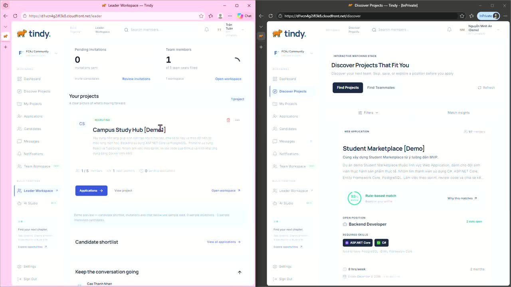
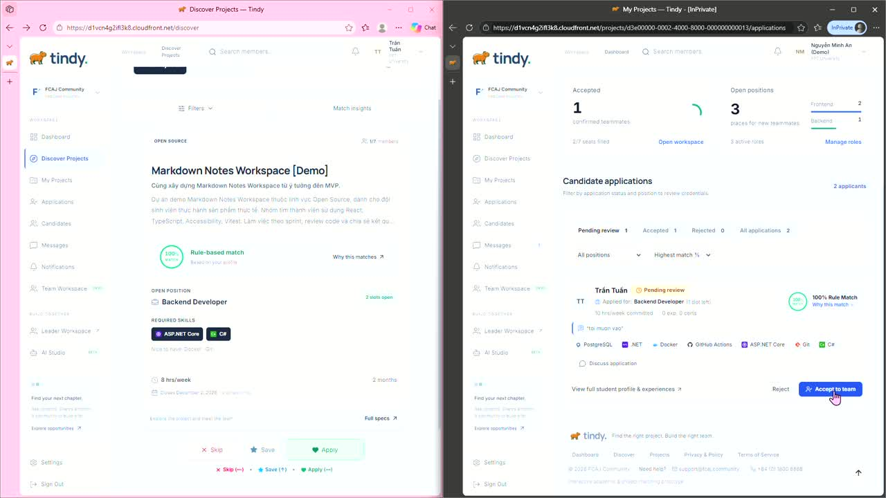
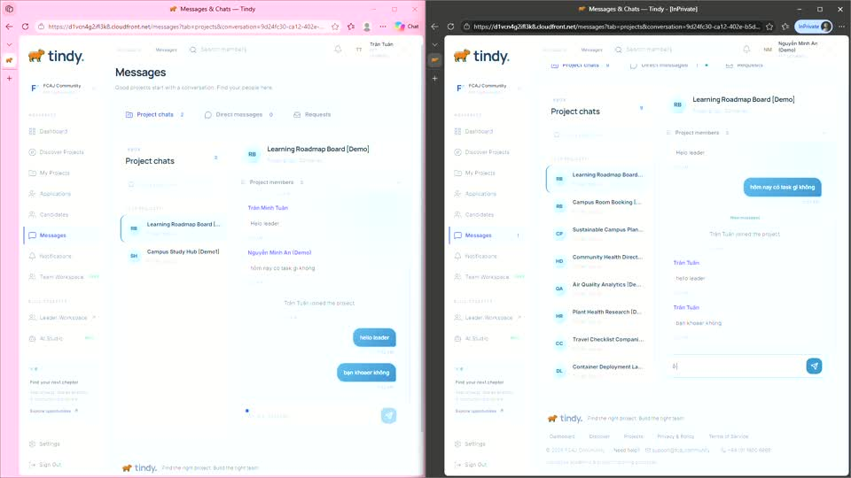
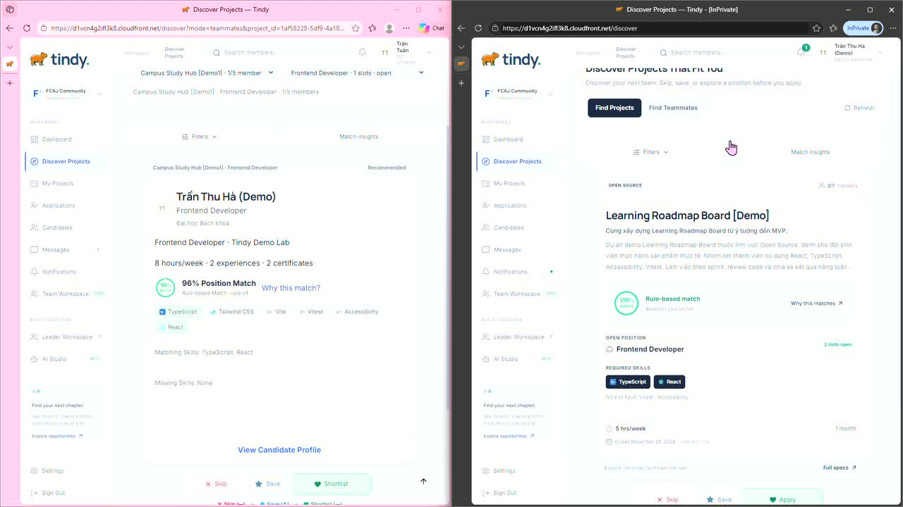
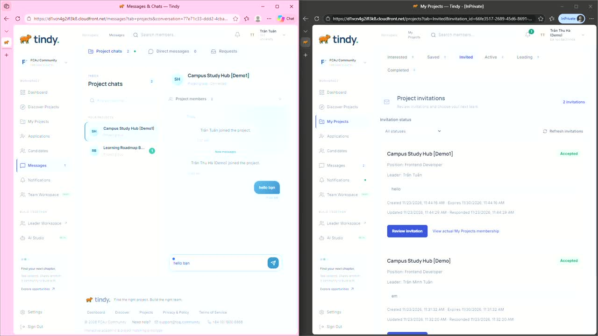
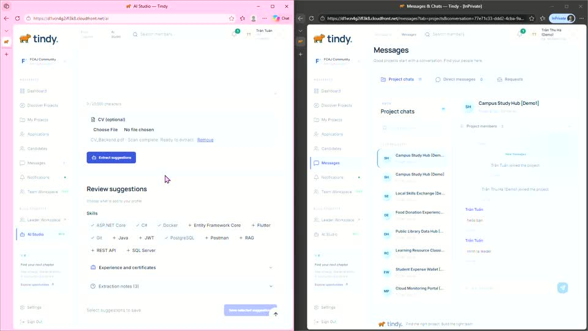
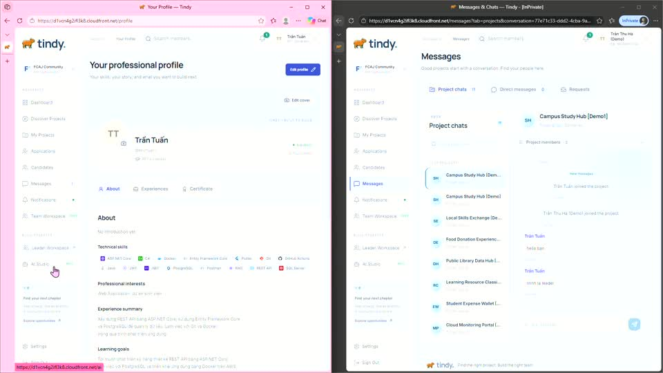

Sau khi triển khai sáu stack, chạy bootstrap, migration, seed và mở Edge sang live, chúng ta kiểm tra Tindy qua giao diện web. Phần này ghi lại hành trình của một Backend Developer: hoàn thiện hồ sơ, tạo dự án, tìm cơ hội và đồng đội, trao đổi trong nhóm, sau đó bổ sung thông tin hồ sơ bằng CV PDF.

## Video demo

Video được quay ngày **23/11/2026**, dài khoảng **7 phút 22 giây**. Hai cửa sổ trình duyệt thể hiện hai phiên đăng nhập riêng để quan sát tương tác giữa thành viên và leader. Có thể mở toàn màn hình để đọc rõ các biểu mẫu và tin nhắn.



### Mốc theo dõi

Các mốc dưới đây gần đúng, dùng để định vị các đoạn chính trong video.

| Thời gian | Nội dung |
| --- | --- |
| 00:00–01:50 | Phiên đăng nhập và onboarding hồ sơ Backend Developer. |
| 01:50–03:05 | Tạo và công bố dự án Campus Study Hub [Demo]. |
| 03:05–04:00 | Tìm dự án, gửi application và xem xét ứng viên ở phía leader. |
| 04:00–04:40 | Trao đổi trong project chat bằng hai phiên đăng nhập. |
| 04:40–06:00 | Tìm teammate, gửi lời mời và quan sát trạng thái Accepted. |
| 06:00–06:25 | Project chat và chuyển sang AI Studio để chọn CV PDF. |
| 06:25–07:22 | AI Studio: CV PDF, scan, trích xuất gợi ý và xem hồ sơ sau cập nhật. |

## 1. Chuẩn bị phiên demo

Truy cập hostname CloudFront của môi trường đã triển khai. Trong lượt thực hành này, URL là `https://d1vcn4g2ifl3k8.cloudfront.net`. Nếu dựng một môi trường mới, lấy `DistributionDomainName` từ Outputs của stack Edge.

Chuẩn bị một tài khoản mới để thực hiện onboarding và một tài khoản demo trong cửa sổ trình duyệt riêng. Tài khoản seed đã hoàn thành onboarding nên phù hợp cho phía nhận application, lời mời và chat. Dùng dữ liệu mẫu cho các thao tác ghi trong bài thực hành.

Trước khi quay, readiness qua CloudFront đã trả HTTP 200 Healthy, ECS chạy một task API và bốn CloudWatch alarm đã được ghi nhận OK. Chi tiết các kiểm tra hạ tầng nằm ở mục 5.4 và 5.5.

## 2. Onboarding hồ sơ Backend Developer

Hoàn thành các bước Basic information, Technical skills, Preferred role, Availability, Interests & Goals, Projects & experience, GitHub & Links và Review & complete profile.

| Nhóm thông tin | Cách thực hành |
| --- | --- |
| Thông tin cơ bản | Điền tên hiển thị, username và trường/cộng đồng. |
| Kỹ năng | Chọn các kỹ năng phù hợp, chẳng hạn .NET, C#, ASP.NET Core, Docker, PostgreSQL và Git. |
| Vai trò | Chọn Backend Developer. |
| Thời gian | Điền số giờ có thể tham gia mỗi tuần. |
| Mục tiêu và kinh nghiệm | Mô tả kinh nghiệm REST API, database và điều muốn học khi làm việc nhóm. |
| Review | Kiểm tra thông tin trước khi hoàn tất hồ sơ. |

Các dữ liệu này giúp người dùng giới thiệu năng lực và cung cấp đầu vào cho matching. Điểm matching được quan sát ở các bước sau là **Rule-based match**.

## 3. Tạo dự án và vị trí tuyển

Mở **Leader Workspace → Create project**. Video tạo `Campus Study Hub [Demo]`, nhập mô tả, chọn Web Application và cấu hình vị trí Frontend Developer với kỹ năng React/TypeScript.

Wizard gồm **The big picture → People & skills → Commitment & review**. Điền nội dung dự án, yêu cầu vị trí, thời gian và hạn tuyển, sau đó review và công bố. Trong đoạn review, dự án có một vị trí mở, cam kết 10 giờ/tuần, thời gian ba tháng và quy mô tối đa năm thành viên.

Sau khi lưu, dự án xuất hiện trong Leader Workspace với trạng thái tuyển dụng. Đây là điểm bắt đầu cho việc nhận application và tìm teammate của chính dự án đó.

## 4. Tìm dự án và xử lý application

Trong **Discover Projects → Find Projects**, xem thẻ dự án, vị trí đang tuyển và điểm phù hợp. Mở chi tiết hoặc phần giải thích matching để đối chiếu yêu cầu trước khi ứng tuyển.

Video gửi application cho `Learning Roadmap Board [Demo]`, chọn vị trí Backend Developer và thêm lời nhắn. Ở phiên leader, màn hình Candidate applications hiển thị ứng viên và nút **Accept to team**. Sau phần xử lý application, hai người dùng xuất hiện trong project chat.

Không dùng số điểm cụ thể trong video làm yêu cầu cố định cho mọi tài khoản. Kết quả phụ thuộc hồ sơ, vị trí, thời gian và dữ liệu hiện tại.

## 5. Chat giữa các thành viên

Mở **Messages → Project chats**, chọn dự án mà hai tài khoản cùng tham gia. Gửi tin nhắn từ một phía và quan sát tin nhắn ở cửa sổ còn lại, sau đó trả lời để kiểm tra chiều ngược lại.

Video thể hiện trao đổi hai chiều trong project chat của `Learning Roadmap Board [Demo]`. Sau khi nhận teammate, project chat của `Campus Study Hub [Demo]` cũng hiển thị thành viên và tin nhắn. Đây là bằng chứng hành vi trên giao diện; video không có màn hình DevTools xác nhận riêng mã WebSocket 101.

## 6. Tìm teammate và gửi lời mời

Chuyển sang **Find Teammates**, chọn dự án mình làm leader và vị trí cần tuyển. Video chọn `Campus Study Hub [Demo]` cùng vị trí Frontend Developer. Thẻ ứng viên thể hiện kỹ năng, thời gian tham gia và Position Match để leader cân nhắc.

Thực hiện luồng shortlist/lời mời trên ứng viên phù hợp. Phía tài khoản nhận mở **My Projects → Invited** để xem và phản hồi. Video có trạng thái invitation **Accepted**, thông báo thành viên tham gia và project chat của nhóm.

## 7. Thực hành bổ sung: chứng chỉ và tài liệu hồ sơ

Luồng chứng chỉ có thể thực hành riêng trong **Profile → Certificate**. Điền đúng tên chứng chỉ, đơn vị cấp và ngày cấp, rồi chọn file đính kèm phù hợp. Nếu dùng tài liệu tự tạo, ghi rõ Demo để phân biệt với chứng chỉ thật. Các khung hình đã đối chiếu trong video chưa xác nhận hoàn tất luồng chứng chỉ; file PDF thể hiện rõ ở cuối video là CV trong AI Studio.

Phân biệt việc lưu thông tin chứng chỉ với kết quả xử lý file. Chỉ kết luận PDF chứng chỉ đã sẵn sàng khi giao diện hiển thị trạng thái tương ứng và có thể xem tài liệu. Đoạn chọn file không tự xác nhận kết quả malware scan của tài liệu đó.

## 8. AI Studio: từ CV PDF đến hồ sơ

Mở **AI Studio**, chọn CV trong **CV (optional)**. Ứng dụng hỗ trợ PDF tối đa 2 MiB và 10 trang theo giao diện hiện tại. Chờ scan hoàn tất rồi bấm **Extract suggestions**.

Trong video, `CV_Backend.pdf` hiển thị **Scan complete. Ready to extract.**. Review suggestions trả về danh sách kỹ năng và các mục Experience and certificates, Extraction notes. Người dùng chọn thông tin phù hợp, lưu và mở lại hồ sơ để xem Technical skills.

Người dùng review kết quả trước khi lưu vào hồ sơ. Điểm Rule-based match ở Discovery và nội dung trích xuất trong AI Studio là hai chức năng khác nhau.

## Kết quả và phạm vi nghiệm thu

| Luồng | Bằng chứng ghi nhận |
| --- | --- |
| Hồ sơ | Onboarding và truy cập workspace bằng phiên đăng nhập. |
| Dự án | Tạo dự án, xuất hiện trong Leader Workspace. |
| Application | Gửi application, leader xem ứng viên và thao tác chấp nhận. |
| Teammate | Xem matching, gửi lời mời, trạng thái Accepted và thành viên trong chat. |
| Chat | Tin nhắn hiển thị giữa hai phiên trong project chat. |
| Chứng chỉ | Hướng dẫn thực hành bổ sung; chưa ghi nhận bằng chứng hoàn tất trong các đoạn video đã đối chiếu. |
| AI PDF | Trạng thái scan hoàn tất, kết quả trích xuất và hồ sơ sau cập nhật. |

Sau khi hoàn tất nghiệm thu và lưu bằng chứng, thực hiện [5.7 Dọn dẹp tài nguyên](../5.7-Cleanup/) theo kế hoạch vận hành.
