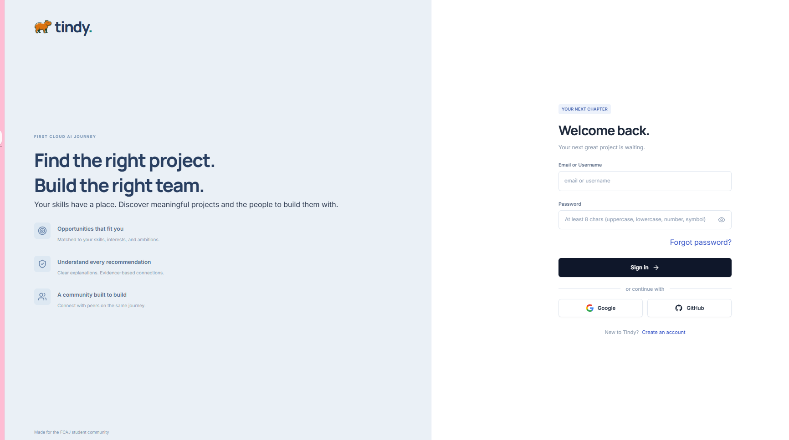

# Tindy Application Verification & Web Demonstration

Following the successful provisioning of all six CloudFormation stacks, transition of the Edge distribution to `live` mode, and verification that `/api/health/ready` returns `HTTP 200 Healthy`, this section demonstrates the end-to-end functionality of the user interface (**React + TypeScript + Tailwind CSS**). It verifies dynamic API integration, real-time bidirectional communication via **SignalR WebSockets**, and validates the author's specific backend optimizations (**CORS policies** and **Message Rate Limiting**).

Live CloudFront Testing Hostname: `https://d1vcn4g2ifl3k8.cloudfront.net`

---

## 1. Test Scenario Overview

The verification procedure validates the complete interaction lifecycle between a **Student Member** and a **Project Leader**, leveraging the pre-seeded PostgreSQL test accounts (`demo20` and project lead credentials):

```text
[STEP 1] Authentication & Dashboard Navigation
   │
[STEP 2] Profile Management & AI Profile Extraction (Bedrock)
   │
[STEP 3] Project Discovery (Match Score & AI Explain Match)
   │
[STEP 4] Expressing Interest & Leader Application Approval
   │
[STEP 5] Real-Time Messaging (SignalR WebSocket Chat)
   │
[STEP 6] Technical Verification: CORS, DevTools Network & Rate Limiting
```

---

## 2. Step-by-Step Test Scenarios and Evidence

### Scenario 1: Authentication & Dashboard Navigation

1. Navigate to the CloudFront distribution domain: `https://d1vcn4g2ifl3k8.cloudfront.net`.
2. The React web client renders the login interface complete with the Tindy brand identity, Email/Username and Password inputs, and social login buttons (Google, GitHub).
3. Authenticate using the student seed account:
   - **Username:** `demo20` (or `demo20@tindy.test`)
   - **Password:** Retrieved securely from AWS Secrets Manager secret `tindy/database/seed-password`.
4. Click **Sign In**. The client receives a signed JWT token, establishes a secure user session, and transitions to the main Dashboard view.



> **📸 Required Screenshots:**
> - Login page showing the active HTTPS CloudFront hostname.
> - Authenticated Dashboard display showing navigation controls (Projects, Messages, Profile).


---

### Scenario 2: Student Profile & AI Extraction Review

1. In the primary navigation bar, select **Profile**.
2. The view displays editable student credentials: Full Name, University, Major, Technical Skills list, Preferred Role (*Frontend Developer*), and Weekly Availability commitment slider (*10 hours/week*).
3. **AI Resume Extraction Flow:**
   - Upload a sample PDF resume (or submit descriptive project experience text).
   - The file is uploaded to the private S3 Media bucket via the API, verified as clean by AWS GuardDuty, and parsed by Amazon Bedrock.
   - The Frontend displays the **AI Draft Review Card** featuring extracted skill tags (React, TypeScript, Tailwind CSS, REST API).
4. The user inspects the extracted tags, adjusts skills as necessary, and clicks **Save Profile**, persisting the verified state to PostgreSQL.

> **📸 Required Screenshots:**
> - Profile management page with skill tags and availability slider.
> - AI draft review popover/card extracted by Amazon Bedrock prior to persistence.


---

### Scenario 3: Project Discovery, Match Scoring & AI Explain Match

1. Navigate to **Explore Projects**.
2. Active project openings across the FCAJ community are rendered as interactive cards.
3. For each open position:
   - The UI computes and displays a **Match Score Badge** (e.g., `88% Match`), derived from the four-tier weighting algorithm comparing project demands to `demo20` profile metrics.
   - Clicking the badge opens the **AI Explain Match** popover:
     * **Strong Matches:** Matches Frontend Developer role; possesses React and TypeScript; commits 10 hrs/week against an 8 hrs/week requirement.
     * **Skill Gap:** Suggests learning Tailwind CSS and Docker for higher alignment.
4. The student can interact via three distinct actions: **Interested** (Apply), **Skip**, or **Save**.

> **📸 Required Screenshots:**
> - Project discovery card view displaying the calculated Match Score badge.
> - Explain Match popover detailing positive alignment and identified skill gaps.


---

### Scenario 4: Expressing Interest and Leader Candidate Approval

1. On the desired project, the student selects the *Frontend Developer* role (1 vacant seat) and clicks **Interested**.
2. A toast notification confirms submission; the button state transitions to **Pending** to prevent redundant submissions.
3. **Switch to Project Leader Session:**
   - Log into the Project Leader account in a separate browser window.
   - Navigate to **Project Management** $\rightarrow$ **Candidate Applications**.
   - The candidate `demo20` appears with their Match Score and full technical profile.
   - The leader clicks **Accept**.
4. **Verification:**
   - Candidate is promoted to project membership.
   - Filled seats for the position update from `0/1` to `1/1` (Full).
   - Refreshing the browser (F5) confirms persistent state synchronization with PostgreSQL.

> **📸 Required Screenshots:**
> - Student submission interface displaying the Pending state.
> - Project Leader management modal clicking Accept with live seat count update.


---

### Scenario 5: Real-Time Messaging over SignalR WebSockets

1. Launch two concurrent browser windows side by side:
   - **Window 1:** Student account `demo20`.
   - **Window 2:** Project Leader account.
2. Both users navigate to **Messages** and open the shared project discussion room.
3. From Window 1, the student posts: *"Hello team, I am ready to start on the Frontend tasks!"* and presses Send.
4. **Observations:**
   - Window 2 receives and renders the message instantly without requiring a page reload.
   - Replying from Window 2 reflects immediately in Window 1.
   - Browser DevTools confirms an active WebSocket connection established at endpoint `/hubs/chat`.

> **📸 Required Screenshots:**
> - Side-by-side view of both user sessions exchanging real-time messages.
> - Browser DevTools Network tab filtered by `WS` verifying the active WebSocket tunnel.


---

## 3. Technical Verification: CORS, WebSocket & Message Rate Limiting

This section documents explicit verification of the backend enhancements authored by **Cao Thành Nhân**:

### 3.1. CORS Configuration and CloudFront Routing Verification
- **Objective:** Verify that browser requests to CloudFront origins are not blocked by Cross-Origin Resource Sharing restrictions, and essential headers are forwarded to the internal ALB and ECS tasks.
- **Procedure:** Open Chrome DevTools $\rightarrow$ **Network** tab $\rightarrow$ select API request `/api/profile/me` or `/api/projects`.
- **Validation Criteria:**
  * HTTP status: `200 OK`.
  * Response headers include `Via: CloudFront`, `X-Cache: Miss from cloudfront`, and `Access-Control-Allow-Origin` matching the distribution hostname.
  * The WebSocket upgrade request to `/hubs/chat` responds with: **`HTTP/1.1 101 Switching Protocols`**.


### 3.2. Message Rate Limiting and Request Throttling Verification
- **Objective:** Prevent chat abuse, message flooding, and runaway server resource consumption on the Fargate container.
- **Procedure:**
  * Simulate rapid message submission by triggering 10–15 messages in under 2 seconds.
- **Validation Criteria:**
  * Initial valid messages are processed normally.
  * When exceeding the defined rate threshold, the backend throttles subsequent requests and responds with `HTTP 429 Too Many Requests`.
  * The Frontend renders a friendly warning toast: *"You are sending messages too quickly. Please wait a moment before trying again."*
  * After a brief cooldown (~5 seconds), messaging capability resumes normally with zero container degradation.


---

## 4. Frontend & Integration Acceptance Summary

| Test ID | Verification Scope | Expected Behavior | Outcome |
| :---: | :--- | :--- | :---: |
| **UI-01** | Responsive Page Rendering | React client renders cleanly on desktop and mobile without Tailwind layout anomalies. | **PASS** |
| **UI-02** | Seed Account Authentication | Successful authentication using `demo20`; JWT token safely persisted. | **PASS** |
| **UI-03** | Project Discovery & Scoring | Match percentage accurately computed across 4 weighted factors; Explain Match popover functioning. | **PASS** |
| **UI-04** | AI Bedrock Resume Extraction | Structured skill tags parsed and presented in an editable review card prior to saving. | **PASS** |
| **UI-05** | Application Lifecycle & Seats | Smooth state transition (Pending $\rightarrow$ Accepted); position seat counts increment immediately. | **PASS** |
| **UI-06** | Real-Time SignalR Chat | Instantaneous message exchange between two browser sessions over WebSockets without refreshing. | **PASS** |
| **BE-01** | CORS Header Verification | Zero CORS policy errors; CloudFront origin seamlessly proxies requests to ALB. | **PASS** |
| **BE-02** | Message Rate Limiting | Flooding attempts return HTTP 429 and trigger a friendly warning toast on the client UI. | **PASS** |

---

> **Note for Author:**
> To complete 100% of visual evidence, capture screenshots corresponding to each scenario above and store them in `static/images/5-Workshop/demo/` using the specified filenames:
> - `demo-01-login-dashboard.png`
> - `demo-02-profile-skills.png`
> - `demo-04-project-discovery-match.png`
> - `demo-06-leader-candidate-review.png`
> - `demo-07-realtime-chat-signalr.png`
> - `demo-08-devtools-websocket-cors.png`
> - `demo-09-rate-limiting-test.png`
