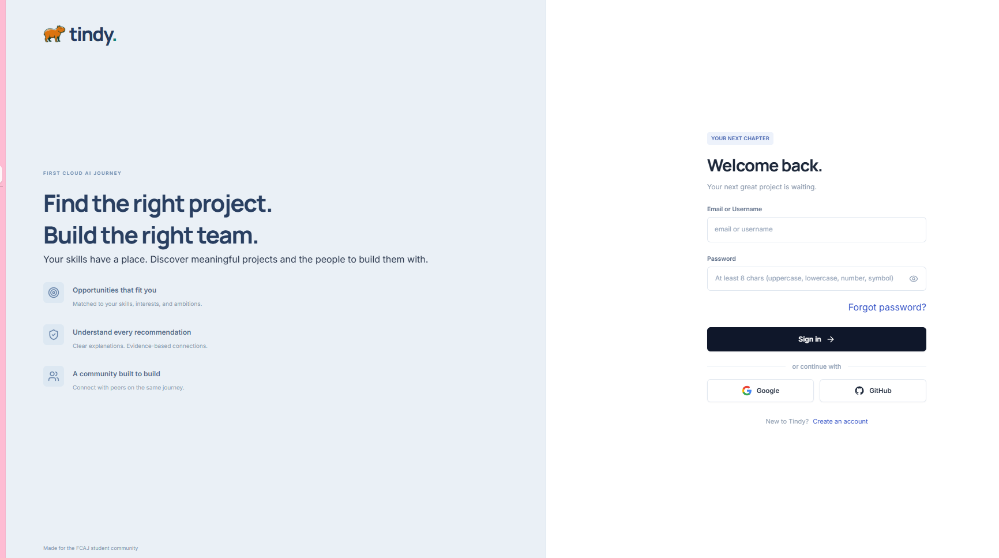

# Kiểm tra ứng dụng và Kịch bản Demo giao diện Tindy

Sau khi hoàn tất triển khai cả 6 stack CloudFormation, Edge đã chuyển sang chế độ `live` và API trả về `HTTP 200 Healthy`, phần này thực hiện kiểm thử toàn diện giao diện người dùng (**React + TypeScript + Tailwind CSS**), kiểm tra khả năng tích hợp API động, kiểm thử kết nối WebSocket thời gian thực (**SignalR**), đồng thời xác minh hai đóng góp kỹ thuật tối ưu Backend của tác giả (**CORS** và **Message Rate Limiting**).

Hostname thử nghiệm trực tiếp qua CloudFront: `https://d1vcn4g2ifl3k8.cloudfront.net`

---

## 1. Tổng quan kịch bản kiểm thử (Test Scenario Overview)

Kịch bản demo được thiết kế để kiểm chứng trọn vẹn luồng tương tác giữa **Sinh viên (Student)** và **Trưởng nhóm dự án (Project Leader)** dựa trên dữ liệu mẫu đã seed vào PostgreSQL (`demo20` và các tài khoản mẫu của hệ thống):

```text
[BƯỚC 1] Đăng nhập & Điều hướng Dashboard
   │
[BƯỚC 2] Quản lý Hồ sơ & Trích xuất AI Profile (Bedrock)
   │
[BƯỚC 3] Khám phá Dự án (Match Score & AI Explain Match)
   │
[BƯỚC 4] Bày tỏ quan tâm (Interested) & Trưởng nhóm duyệt đơn
   │
[BƯỚC 5] Trò chuyện thời gian thực (SignalR WebSocket Chat)
   │
[BƯỚC 6] Kiểm tra kỹ thuật: CORS, DevTools Network & Rate Limiting
```

---

## 2. Kịch bản chi tiết và Minh chứng thực tế

### Kịch bản 1: Đăng nhập và Khởi tạo giao diện (Authentication & Dashboard)

1. Mở trình duyệt web và truy cập hostname CloudFront: `https://d1vcn4g2ifl3k8.cloudfront.net`.
2. Giao diện đăng nhập React hiển thị form xác thực với logo Tindy, trường nhập Email/Username, Mật khẩu và các nút đăng nhập mạng xã hội (Google, GitHub).
3. Sử dụng tài khoản demo sinh viên:
   - **Tài khoản:** `demo20` (hoặc `demo20@tindy.test`)
   - **Mật khẩu:** Lấy từ AWS Secrets Manager `tindy/database/seed-password`.
4. Bấm **Sign In**. Giao diện xác thực JWT token, lưu trữ phiên an toàn và điều hướng vào trang Dashboard chính của Tindy.



> **📸 Minh chứng cần có:**
> - Ảnh màn hình đăng nhập hiển thị đầy đủ URL HTTPS CloudFront.
> - Ảnh Dashboard sau khi đăng nhập thành công, hiển thị thanh điều hướng (Projects, Messages, Profile).


---

### Kịch bản 2: Hồ sơ sinh viên & Duyệt bản nháp AI (Profile Builder & AI Extraction)

1. Trên menu điều hướng, chọn **Profile**.
2. Giao diện hiển thị các trường thông tin: Họ tên, Trường, Chuyên ngành, Danh mục kỹ năng (Skills), Vai trò mong muốn (Preferred Role: Frontend Developer) và Thanh trượt thời gian khả dụng (Availability: 10 giờ/tuần).
3. **Thử nghiệm trích xuất AI:**
   - Tải lên tệp CV mẫu định dạng PDF (hoặc nhập đoạn văn bản mô tả kinh nghiệm).
   - Hệ thống chuyển tệp lên S3 Media Bucket qua API, GuardDuty quét virus thành công và Amazon Bedrock tiến hành trích xuất kỹ năng.
   - Giao diện Frontend hiển thị **Bản nháp hồ sơ AI (AI Draft Review Card)** gồm các thẻ kỹ năng được gắn nhãn (React, TypeScript, Tailwind CSS, REST API).
4. Người dùng trực tiếp rà soát, chỉnh sửa thẻ kỹ năng và bấm **Save Profile**. Dữ liệu được ghi nhận vào PostgreSQL.

> **📸 Minh chứng cần có:**
> - Ảnh màn hình trang Profile với các trường kỹ năng và thanh trượt thời gian khả dụng.
> - Ảnh popover/card duyệt bản nháp do Amazon Bedrock trích xuất trước khi lưu.


---

### Kịch bản 3: Khám phá dự án, Điểm tương thích & AI Explain Match

1. Chọn mục **Explore Projects** trên thanh điều hướng.
2. Danh sách các dự án đang tuyển thành viên trong cộng đồng FCAJ hiển thị dưới dạng thẻ (Project Cards).
3. Với mỗi vị trí đang tuyển:
   - Frontend hiển thị huy hiệu điểm tương thích **Match Score** (ví dụ: `88% Match`). Điểm này được tính toán dựa trên công thức trọng số kết hợp giữa kỹ năng, vai trò và thời gian khả dụng của sinh viên `demo20`.
   - Bấm vào huy hiệu điểm hoặc nút **Why this project?**, giao diện mở popover **AI Explain Match**:
     * **Strong Matches:** Trùng khớp vai trò Frontend Dev; Có kỹ năng React, TypeScript; Thời gian 10h/tuần đáp ứng yêu cầu 8h/tuần.
     * **Skill Gap:** Dự án ưu tiên thêm kỹ năng Tailwind CSS và Docker.
4. Sinh viên có 3 lựa chọn tương tác nhanh: **Interested** (Ứng tuyển), **Skip** (Bỏ qua), **Save** (Lưu xem sau).

> **📸 Minh chứng cần có:**
> - Ảnh danh sách thẻ dự án với Match Score badge.
> - Ảnh popover AI Explain Match phân tích điểm mạnh và điểm cần cải thiện.


---

### Kịch bản 4: Bày tỏ quan tâm (Interested) và Trưởng nhóm duyệt đơn

1. Tại dự án cần tham gia, sinh viên chọn vị trí *Frontend Developer* (còn 1 chỗ trống) và bấm nút **Interested**.
2. Giao diện hiển thị thông báo Toast xác nhận đơn đã gửi thành công; trạng thái nút chuyển sang **Pending** để tránh việc bấm lặp lại.
3. **Đổi sang góc nhìn Trưởng nhóm (Project Leader):**
   - Đăng nhập tài khoản Leader của dự án.
   - Mở trang **Project Management** $\rightarrow$ chọn mục **Candidate Applications**.
   - Danh sách hiển thị ứng viên `demo20` kèm điểm match và hồ sơ chi tiết.
   - Trưởng nhóm bấm **Accept** (Chấp nhận).
4. **Kết quả xác minh:**
   - Hệ thống tạo quan hệ thành viên dự án (Team Member).
   - Số chỗ đã dùng của vị trí tuyển dụng tăng từ `0/1` lên `1/1` (Hết chỗ).
   - Tải lại trang (F5) để kiểm tra: Trạng thái dữ liệu vẫn đồng bộ chính xác từ PostgreSQL.

> **📸 Minh chứng cần có:**
> - Ảnh thao tác bấm Interested từ phía sinh viên (trạng thái Pending).
> - Ảnh màn hình Project Leader bấm Accept và số lượng chỗ ngồi (Seats) cập nhật tự động.


---

### Kịch bản 5: Trò chuyện thời gian thực qua SignalR WebSocket (Internal Chat)

1. Mở hai cửa sổ trình duyệt song song (hoặc 1 tab thường và 1 tab ẩn danh):
   - **Cửa sổ 1:** Tài khoản sinh viên `demo20`.
   - **Cửa sổ 2:** Tài khoản Trưởng nhóm dự án.
2. Cả hai người dùng cùng mở mục **Messages** và truy cập vào cuộc hội thoại chung của dự án.
3. Từ Cửa sổ 1, sinh viên nhập tin nhắn: *"Chào team, mình đã sẵn sàng cho task Frontend!"* và bấm Gửi.
4. **Kết quả quan sát:**
   - Cửa sổ 2 nhận được tin nhắn tức thời mà **không** cần phải tải lại trang web.
   - Thử nghiệm gửi phản hồi từ Cửa sổ 2, Cửa sổ 1 nhận tin nhắn ngay lập tức.
   - Kiểm tra F12 DevTools ghi nhận kết nối WebSocket duy trì liên tục qua endpoint `/hubs/chat`.

> **📸 Minh chứng cần có:**
> - Ảnh chụp 2 cửa sổ chat song song hiển thị các tin nhắn trao đổi thời gian thực.
> - Ảnh F12 Developer Tools tab Network lọc mục `WS` hiển thị kết nối WebSocket đang hoạt động.


---

## 3. Kiểm tra kỹ thuật: CORS, WebSocket & Message Rate Limiting

Phần này ghi lại bằng chứng kiểm thử chuyên sâu đối với các tối ưu hóa Backend mà tác giả (**Cao Thành Nhân**) đã thực hiện:

### 3.1. Xác minh cấu hình CORS và định tuyến CloudFront
- **Mục tiêu:** Đảm bảo toàn bộ request API từ trình duyệt gửi tới CloudFront hostname không bị chặn bởi chính sách bảo mật Cross-Origin của trình duyệt, đồng thời các header cần thiết được chuyển tiếp chính xác đến ALB và ECS Fargate.
- **Thao tác:** Mở Chrome DevTools $\rightarrow$ tab **Network** $\rightarrow$ chọn request API `/api/profile/me` hoặc `/api/projects`.
- **Kết quả đạt:**
  * Status code: `200 OK`.
  * Response headers có `Via: CloudFront`, `X-Cache: Miss from cloudfront`, `Access-Control-Allow-Origin` khớp với hostname truy cập.
  * Request nâng cấp giao thức WebSocket `/hubs/chat` trả về mã trạng thái: **`HTTP/1.1 101 Switching Protocols`**.


### 3.2. Xác minh cơ chế Giới hạn tần suất tin nhắn (Message Rate Limiting & Throttling)
- **Mục tiêu:** Bảo vệ API và Fargate task không bị treo khi có hành vi spam tin nhắn hoặc gửi request dồn dập trong phòng chat.
- **Thao tác thử nghiệm:**
  * Sử dụng script kiểm thử tự động hoặc gửi liên tiếp 10–15 tin nhắn trong vòng dưới 2 giây trên giao diện chat.
- **Kết quả đạt:**
  * Các tin nhắn đầu tiên được gửi đi bình thường.
  * Khi vượt quá ngưỡng cấu hình cho phép, Backend chặn request và trả về mã lỗi `429 Too Many Requests`.
  * Giao diện Frontend hiển thị Toast cảnh báo thân thiện: *"Bạn đang gửi tin nhắn quá nhanh, vui lòng chờ trong giây lát trước khi gửi tiếp."*
  * Sau khoảng thời gian hạ nhiệt (cooldown ~5 giây), người dùng tiếp tục gửi tin nhắn bình thường mà không gây ảnh hưởng đến hệ thống.


---

## 4. Bảng tổng kết nghiệm thu chức năng Frontend

| Mã ca thử | Nội dung kiểm thử | Kết quả mong đợi | Đánh giá thực tế |
| :---: | :--- | :--- | :---: |
| **UI-01** | Tải trang & Giao diện Responsive | Giao diện React hiển thị chuẩn trên cả desktop và mobile, không vỡ layout Tailwind. | **ĐẠT (PASS)** |
| **UI-02** | Đăng nhập tài khoản seed | Đăng nhập thành công với `demo20`, lưu JWT phiên an toàn. | **ĐẠT (PASS)** |
| **UI-03** | Khám phá dự án & Match Score | Hiển thị % match chính xác theo 4 tiêu chí trọng số; Explain Match popover rõ ràng. | **ĐẠT (PASS)** |
| **UI-04** | Trích xuất CV bằng AI Bedrock | Trích xuất kỹ năng thành các thẻ có cấu trúc; hỗ trợ người dùng chỉnh sửa trước khi lưu. | **ĐẠT (PASS)** |
| **UI-05** | Luồng Ứng tuyển & Duyệt đơn | Trạng thái chuyển đổi nhịp nhàng (Pending $\rightarrow$ Accepted); số chỗ tuyển dụng cập nhật tức thì. | **ĐẠT (PASS)** |
| **UI-06** | Real-time Chat SignalR | Nhận và gửi tin nhắn tức thời giữa 2 tài khoản qua WebSocket không cần F5. | **ĐẠT (PASS)** |
| **BE-01** | CORS Header Verification | Trình duyệt không báo lỗi CORS; CloudFront chuyển tiếp mượt mà tới Internal ALB. | **ĐẠT (PASS)** |
| **BE-02** | Message Rate Limiting | Ngăn chặn spam tin nhắn dồn dập với mã HTTP 429 và thông báo Toast cảnh báo trên UI. | **ĐẠT (PASS)** |

---

> **Hướng dẫn dành cho tác giả:**
> Để bài báo cáo hoàn thiện 100% hình ảnh thực tế, bạn chỉ cần chụp ảnh màn hình các bước demo tương ứng theo danh sách trên và lưu tệp vào thư mục `static/images/5-Workshop/demo/` với đúng các tên file:
> - `demo-01-login-dashboard.png`
> - `demo-02-profile-skills.png`
> - `demo-04-project-discovery-match.png`
> - `demo-06-leader-candidate-review.png`
> - `demo-07-realtime-chat-signalr.png`
> - `demo-08-devtools-websocket-cors.png`
> - `demo-09-rate-limiting-test.png`
